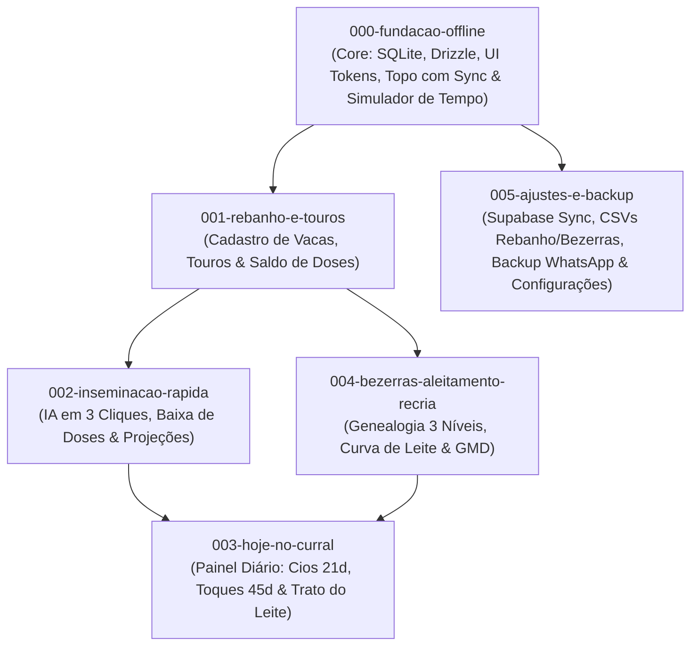

# ReproLeite — Roadmap de Features para o Spec Kit

Documento de referência consolidado para a implementação do aplicativo móvel nativo **ReproLeite** utilizando o fluxo do **Spec Kit** (`/speckit-specify`, `/speckit-plan`, `/speckit-tasks`, `/speckit-implement`).

---

## 1. Visão Geral da Arquitetura & Diretrizes de Engenharia

- **Distribuição & Plataforma**: Aplicativo **100% Nativo** (Android / iOS via Expo Development Build e EAS Build / APK). *Nota: A arquitetura PWA via navegador foi descartada para evitar exclusão silenciosa de dados pelo IndexedDB no iOS e limitações de notificações.*
- **Offline-First Absoluto (Modo Curral)**: Todas as leituras e gravações da interface ocorrem de forma síncrona exclusivamente no SQLite local (`expo-sqlite` + Drizzle ORM). Nenhuma tela ou ação de manejo depende de conexão com a internet.
- **Identificador Universal UUID v4**: Todas as entidades (`animals`, `inseminations`, `bulls`, `weighings`, `alerts`, `farms`) utilizam UUID v4 gerado no cliente, eliminando colisões de chaves mesmo quando dois aparelhos registram dados offline no mesmo instante.
- **Resolução de Conflitos Last-Write-Wins (LWW)**: Todas as tabelas contêm `created_at` e `updated_at` (UTC). Na sincronização com o Supabase, divergências simultâneas são resolvidas deterministicamente pela alteração mais recente.
- **Exclusão Segura (Soft Delete)**: Registros contêm `deleted_at: string | null`. Animais excluídos ou saídos do rebanho nunca sofrem `DELETE` físico imediato, preservando a integridade do histórico genealógico e permitindo a propagação de tombstones no sync.
- **Multi-Tenant Nativo**: Todo registro possui `farm_id: string` (UUID), isolando os dados de cada propriedade rural desde a primeira versão.
- **Ergonomia Rural**: Botões primários com altura mínima de 56 px (`min-h-14`), controles de 48 px (`min-h-12`), paleta de alto contraste para leitura sob sol intenso e foco em teclado numérico.
- **Biblioteca de Ícones Oficial**: **`lucide-react-native`** (com **`react-native-svg`**) adotada como padrão visual único para iconografia das abas, botões, cabeçalho e sinalizadores zootécnicos.

---

## 2. Mapa de Dependências das Features



---

## 3. Especificação Detalhada das Features

### Feature 000: `000-fundacao-offline`
**Tema:** Infraestrutura Core, Banco Local, Design System, Topo com Indicador de Sync e Simulador de Tempo  
**Status:** Pré-requisito para todas as telas

- **Escopo**:
  - Configuração do SQLite local com `expo-sqlite` e Drizzle ORM.
  - Campos padrão em todas as tabelas: `id` (UUID v4), `farm_id` (UUID), `created_at` (UTC), `updated_at` (UTC), `deleted_at` (UTC/null).
  - Regra LWW (Last-Write-Wins) estruturada para a camada de persistência.
  - Design system com tokens rurais em `tailwind.config.js`:
    - Cores: Verde pasto (`#1b4332`), Terra, Âmbar para alertas e alto contraste.
    - Componentes base em `src/ui/`: `Botao`, `CampoNumerico`, `Cartao`, `SeloStatus`, `CabecalhoStatusSimulador`.
  - **Barra Superior Persistente no Cabeçalho**:
    1. **Data de Manejo & Simulador Temporal**:
       - Exibição da data atual de trabalho com seletor interativo.
       - Atalhos rápidos: `+1 dia`, `+7 dias`, `+21 dias (Cio)`, `Resetar para Hoje`.
       - Todas as consultas de alertas e cálculos do app usam essa data simulada como referência.
    2. **Indicador Visível de Proteção e Sincronização**:
       - 🟢 *Nuvem Protegida · Sincronizado agora / há X min*
       - 🟡 *X alterações pendentes de envio (Modo Curral Offline)*
       - 🔵 *Sincronizando com Supabase...*
    3. **Controles de Campo & Teste**:
       - Botão *"Sincronizar Agora"*.
       - Alternador *"Simular: Com Internet / Sem Internet"* para forçar Modo Curral durante testes.
- **Comando Spec Kit**:
  ```bash
  /speckit-specify 000-fundacao-offline
  ```

---

### Feature 001: `001-rebanho-e-touros`
**Tema:** Aba "Rebanho & Touros" (Animais, Status Reprodutivo e Catálogo de Sêmen)  
**Dependência:** `000-fundacao-offline`

- **Escopo**:
  - **Rebanho:**
    - Listagem ágil com busca instantânea por brinco (numérico) ou nome/apelido.
    - Filtros por status reprodutivo: *Todas, Vazias, Inseminadas, Prenhes, Secas*.
    - Política de reuso de brinco: bloqueio imediato se o brinco estiver em uso por animal ativo; aviso amarelo se pertencer a animal inativo (vendido, descartado, morto).
    - Cadastro rápido de animal (brinco, nome, raça, data de nascimento, peso ao nascer).
  - **Catálogo de Touros:**
    - Cadastro de touro: nome, raça, código da palheta, saldo de doses em estoque e observações.
    - Histórico visual de vacas inseminadas com cada touro.
- **Tabelas Drizzle**:
  - `animals` (id, farm_id, ear_tag, ear_tag_normalized, name, breed, sex, birth_date, birth_weight_kg, life_stage, repro_status, exit_status, exit_date, exit_reason)
  - `bulls` (id, farm_id, name, breed, code, straws_in_stock, notes)
- **Comando Spec Kit**:
  ```bash
  /speckit-specify 001-rebanho-e-touros
  ```

---

### Feature 002: `002-inseminacao-rapida`
**Tema:** Aba "Inseminar" (Lançamento Rápido no Curral & Projeções Imediatas)  
**Dependência:** `001-rebanho-e-touros`

- **Escopo**:
  - **Fluxo de IA em 3 Toques**:
    1. Seleção da vaca (busca por brinco ou nome).
    2. Seleção do touro (dropdown com saldo de doses restante ou digitação de nome avulso).
    3. Data do procedimento (padrão: data atual do simulador) + Inseminador.
  - **Baixa Automática no Estoque de Sêmen**: subtrai 1 dose da palheta do touro selecionado.
  - **Painel de Projeção Zootécnica Imediata (Preview antes de confirmar)**:
    - 📅 *Observação de Retorno do Cio*: Data + 21 dias.
    - 🩺 *Exame de Toque Veterinário*: Data + 45 dias.
    - 🍼 *Previsão de Parto*: Data + 282 dias (~9 meses).
    - 🛑 *Data para Secagem*: Parto - 60 dias.
  - **Alerta Visual de Consanguinidade**: Detecção em destaque amarelo caso o touro selecionado seja pai ou avô da vaca.
  - **Geração de Alertas**: Gravação automática dos marcos na tabela `alerts`.
- **Tabelas Drizzle**:
  - `inseminations` (id, farm_id, animal_id, bull_id, bull_name, date, inseminator, expected_heat_date, pregnancy_check_date, expected_calving_date, dry_off_date, result, notes)
  - `alerts` (id, farm_id, target_animal_id, type, due_date, completed_at, source_id)
- **Comando Spec Kit**:
  ```bash
  /speckit-specify 002-inseminacao-rapida
  ```

---

### Feature 003: `003-hoje-no-curral`
**Tema:** Aba "Hoje no Curral" (Painel Diário de Decisões, Cios, Toques & Trato do Leite)  
**Dependência:** `002-inseminacao-rapida`, `004-bezerras-aleitamento-recria`

- **Escopo**:
  - **Quadro de Cios para Vigiar (Janela de 21 dias)**:
    - Cartões destacados de vacas que atingiram o prazo de 21 dias desde a última IA.
    - Ações em 1 toque:
      - *Repetiu o Cio*: Abre modal para re-inseminar imediatamente com outro touro (arquiva tentativa anterior como vazia).
      - *Não Repetiu*: Confirma que segurou o cio e agenda exame de toque para os 45 dias.
  - **Quadro de Toques Veterinários (45 a 60 dias)**:
    - Lista de vacas aguardando diagnóstico de gestação.
    - Ações em 1 toque:
      - *Confirmar Prenhez*: Altera status da vaca para `prenhe`, confirma as datas previstas de parto e secagem.
      - *Vazia*: Marca a vaca como `vazia`, cancela alertas daquela IA e a deixa pronta para nova cobertura.
  - **Quadro do Bezerreiro (Trato de Hoje)**:
    - Indicador numérico em destaque do volume total de leite a preparar:
      - **Litros da Manhã**
      - **Litros da Tarde**
    - Lista de bezerras que mudam de fase ou iniciam corte gradual de leite na semana.
- **Comando Spec Kit**:
  ```bash
  /speckit-specify 003-hoje-no-curral
  ```

---

### Feature 004: `004-bezerras-aleitamento-recria`
**Tema:** Aba "Bezerras" (Genealogia em 3 Níveis, Curva de Leite & Recria)  
**Dependência:** `001-rebanho-e-touros`

- **Escopo**:
  - **Cadastro de Bezerra**:
    - Brinco, nome, sexo, data de nascimento, peso de nascimento (padrão 40 kg).
    - Genealogia em 3 níveis visuais: Bezerra ➔ Mãe (vaca da fazenda) ➔ Pai (touro) ➔ Avó Materna.
  - **Calculadora Automática de Aleitamento**:
    - 0 a 15 dias: 2 L manhã + 2 L tarde (4 L/dia) - *Fase Inicial*
    - 16 a 100 dias: 4 L manhã + 4 L tarde (8 L/dia) - *Fase de Pico*
    - 101 a 107 dias: 2 L manhã + 2 L tarde (4 L/dia) - *1ª semana de corte*
    - 108 a 114 dias: 1 L manhã + 1 L tarde (2 L/dia) - *2ª semana de corte*
    - 115 a 121 dias: 1 L apenas manhã (1 L/dia) - *3ª semana de corte*
    - 122+ dias: 0 L - *Desmamada*
  - **Linha do Tempo de Desmame**:
    - Datas exatas de calendário para cada degrau de corte até o desmame total.
  - **Acompanhamento de Recria & GMD**:
    - Registro de pesagens mensais.
    - Cálculo automático do Ganho Médio Diário (GMD em g/dia): `(peso_atual - peso_anterior) / dias`.
    - Régua/barra de progresso até a meta da 1ª Inseminação (~360 kg aos 14-16 meses).
    - Botão de ação rápida: *"Apta para IA / Lançar 1ª Inseminação"* ao bater a meta.
- **Tabelas Drizzle**:
  - `animals` (vínculos genealógicos e peso de nascimento)
  - `weighings` (id, farm_id, animal_id, date, weight_kg, notes)
- **Comando Spec Kit**:
  ```bash
  /speckit-specify 004-bezerras-aleitamento-recria
  ```

---

### Feature 005: `005-ajustes-e-backup`
**Tema:** Aba "Ajustes & Backup" (Supabase Sync, CSVs, Backup WhatsApp & Configurações)  
**Dependência:** `000-fundacao-offline`

- **Escopo**:
  - **Login por Conta & Restauração de Desastre (Supabase)**:
    - Autenticação sem atrito via Supabase Auth com código OTP por e-mail (6 dígitos, sem custo).
    - *Acesso Imediato no Curral*: O app abre imediatamente sem bloquear o usuário por login (fazenda local criada no SQLite).
    - O login pode ser realizado a qualquer momento na aba Ajustes para ativar o backup em nuvem.
    - Restauração completa automática ao logar em novo aparelho após perda/dano do celular anterior.
  - **Planilhas CSV Formatadas (Excel / Google Drive)**:
    - **Baixar CSV do Rebanho**: Exporta tabela formatada com vacas, histórico de IA, previsão de retorno de cio, diagnóstico de toque e datas de parto/secagem.
    - **Baixar CSV das Bezerras**: Exporta genealogia completa (Pai, Mãe, Avó), peso ao nascer e histórico de pesagens com GMD.
  - **Backup para WhatsApp em 1 Toque**:
    - Botão "Exportar para WhatsApp": gera cópia de segurança em `.json` ou `.csv` e abre o compartilhamento do WhatsApp (`expo-sharing`).
    - Botão "Copiar Dados": copia o JSON compacto para a área de transferência.
    - Botão "Restaurar Backup JSON": importa o arquivo JSON e recupera a base local.
  - **Parâmetros Zootécnicos da Fazenda**:
    - Configuração dos prazos (padrão: 21 dias retorno de cio, 45 dias toque, 282 dias parto, 60 dias secagem).
    - Metas de peso para 1ª IA por raça (ex: Holandesa 380 kg, Girolando 350 kg).
    - Tabela de volumes de leite configurável por fase.
- **Tabelas Drizzle**:
  - `settings` (id, farm_id, key, value, updated_at)
  - `sync_queue` (apenas local: id, table, record_id, operation, created_at, attempts)
  - `sync_state` (apenas local: last_pulled_at, last_pushed_at, last_success_at)
- **Comando Spec Kit**:
  ```bash
  /speckit-specify 005-ajustes-e-backup
  ```

---

## 4. Guia de Execução no Spec Kit

Para cada feature, execute o ciclo padrão do Spec Kit:

1. **Especificar**:
   ```bash
   /speckit-specify <feature-name>
   ```
2. **Esclarecer dúvidas / refinar (opcional)**:
   ```bash
   /speckit-clarify
   ```
3. **Planejar a arquitetura técnica**:
   ```bash
   /speckit-plan
   ```
4. **Gerar tarefas executáveis**:
   ```bash
   /speckit-tasks
   ```
5. **Implementar**:
   ```bash
   /speckit-implement
   ```

---
*Referência baseada em `_docs/implementation_plan.md` e ratificada pela `.specify/memory/constitution.md`.*
