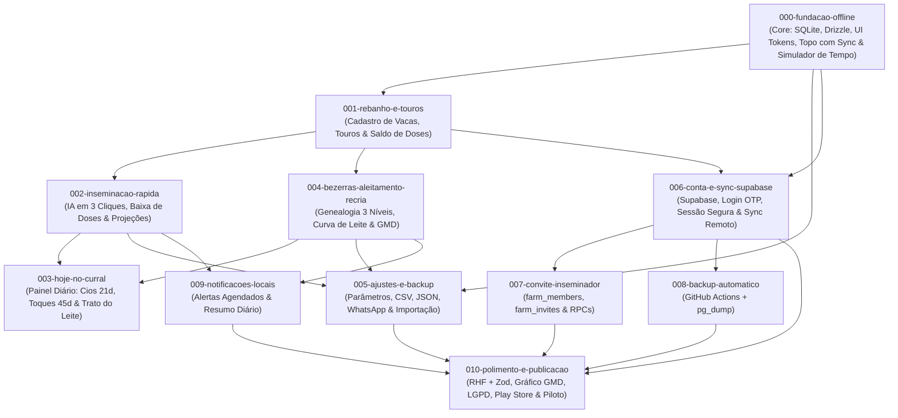

# ReproLeite — Roadmap de Features para o Spec Kit

Documento de referência consolidado para a implementação do aplicativo móvel nativo **ReproLeite** utilizando o fluxo do **Spec Kit** (`/speckit-specify`, `/speckit-plan`, `/speckit-tasks`, `/speckit-implement`).

---

## 1. Visão Geral da Arquitetura & Diretrizes de Engenharia

- **Distribuição & Plataforma**: Aplicativo **100% Nativo** (Android / iOS via Expo Development Build e EAS Build / APK). *Nota: A arquitetura PWA via navegador foi descartada para evitar exclusão silenciosa de dados pelo IndexedDB no iOS e limitações de notificações.*
- **Offline-First Absoluto (Modo Curral)**: Todas as leituras e gravações da interface ocorrem de forma síncrona exclusivamente no SQLite local (`expo-sqlite` + Drizzle ORM). Nenhuma tela ou ação de manejo depende de conexão com a internet.
- **Identificador Universal UUID v4**: Todas as entidades (`animals`, `inseminations`, `bulls`, `weighings`, `alerts`, `farms`) utilizam UUID v4 gerado no cliente, eliminando colisões de chaves mesmo quando dois aparelhos registram dados offline no mesmo instante.
- **Resolução de Conflitos Last-Write-Wins (LWW)**: Todas as tabelas contêm `created_at` e `updated_at` (UTC). Na sincronização com o Supabase, divergências simultâneas são resolvidas deterministicamente pela alteração mais recente.
- **Exclusão Segura (Soft Delete)**: Registros contêm `deleted_at: string | null`. Animais excluídos ou saídos do rebanho nunca sofrem `DELETE` físico imediato, preservando a integridade do histórico genealógico e permitindo a propagação de tombstones no sync.
- **Multi-Tenant Nativo**: Todo registro possui `farm_id: string` (UUID), isolando os dados de cada propriedade rural desde a primeira versão.
- **Ergonomia Rural**: Botões primários com altura mínima de 56 px (`min-h-14`), controles de 48 px (`min-h-12`), paleta de alto contraste para leitura sob sol intenso e foco em teclado numérico.
- **Biblioteca de Ícones Oficial**: **`lucide-react-native`** (com **`react-native-svg`**) adotada como padrão visual único para iconografia das abas, botões, cabeçalho e sinalizadores zootécnicos.

---

## 2. Estado da Implementação (validado em 15/10/2026)

Validação feita contra o código e `specs/*/tasks.md`: `npx tsc --noEmit` sem erros e `npx jest` com **35 suítes / 172 testes passando**. Todas as tarefas de `specs/000` a `specs/005` estão marcadas como concluídas (`[X]`/`[x]`).

| Feature | Spec Kit | Estado | Observação |
| --- | --- | --- | --- |
| 000-fundacao-offline | `specs/000-fundacao-offline` | ✅ Implementada | SQLite + Drizzle, outbox, cabeçalho com simulador de data e indicador de sync, design system. |
| 001-rebanho-e-touros | `specs/001-rebanho-e-touros` | ✅ Implementada | Features `herd` e `bulls`; política de reuso de brinco e saldo de doses. |
| 002-inseminacao-rapida | `specs/002-inseminacao-rapida` | ✅ Implementada | Feature `insemination` (+ `reproduction`, `alerts`); projeções, baixa de dose e consanguinidade. |
| 003-hoje-no-curral | `specs/003-hoje-no-curral` | ✅ Implementada | Feature `today`: cios 21d, toques 45d, trato do bezerreiro e `PendingSyncBadge`. |
| 004-bezerras-aleitamento-recria | `specs/004-bezerras-aleitamento-recria` | ✅ Implementada | Feature `calves`: genealogia, aleitamento, pesagens/GMD, régua de 1ª IA, filtros por sexo. |
| 005-ajustes-e-backup | `specs/005-ajustes-e-backup` | ✅ Implementada | Exportação CSV Rebanho/Bezerras (UTF-8 BOM), Backup JSON WhatsApp e cópia, Restauração atômica com confirmação e edição de parâmetros zootécnicos. |
| 006-conta-e-sync-supabase | _sem spec_ | ⬜ Planejada | Supabase, login OTP, sessão segura, criação automática da fazenda e sync remoto. |
| 007-convite-inseminador | _sem spec_ | ⬜ Planejada | `farm_members`, `farm_invites` e RPCs de convite. |
| 008-backup-automatico | _sem spec_ | ⬜ Planejada | Repositório `backup-rebanho` e workflow diário no GitHub Actions. |
| 009-notificacoes-locais | _sem spec_ | ⬜ Planejada | Alertas agendados e resumo diário. |
| 010-polimento-e-publicacao | _sem spec_ | ⬜ Planejada | Formulários com RHF + Zod, gráfico de GMD, LGPD, build de produção/Play Store e piloto. |

### Não implementado (validado no código) e feature responsável

| Item não implementado | Situação atual | Feature |
| --- | --- | --- |
| **Supabase** | Não há `@supabase/supabase-js` nem referência a Supabase em `src/`. `core/network/api-client.ts` é só a camada de ports, então o sync (push, pull, conflito, scheduler, outbox, já testados) ainda não tem destino remoto. | 006 |
| **Login e conta** | Faltam OTP, `expo-secure-store` e a criação automática da fazenda. O botão "Entrar com Conta" é placeholder. | 006 |
| **Convite do inseminador** | Faltam `farm_members`, `farm_invites` e as RPCs `create_invite`/`accept_invite`. | 007 |
| **Backup Automático** | Não existe `.github/workflows` nem o repositório `backup-rebanho`. | 008 |
| **Notificações** | Falta `expo-notifications` (locais agendadas e resumo diário). | 009 |
| **Conectividade e segundo plano** | O projeto usa `@react-native-community/netinfo`, não `expo-network`. Não há `expo-background-task` nem `expo-task-manager`. | 006 |
| **Formulários** | Não há `react-hook-form` nem `zod`, que a regra do projeto pede; formulários usam estado local. | 010 |
| **Gráfico de GMD** | Nenhuma dependência de gráfico (hoje só régua de progresso e valores). | 010 |
| **Etapas finais** | Sem sinal de LGPD, de build de produção para a Play Store nem do piloto. | 010 |

### Divergências em relação ao plano original

- **Estrutura de pastas:** as tasks dos specs citam `src/db`, `src/domain` e `src/context` (estrutura inicial). O código foi reorganizado para **feature-first + Clean Architecture** (`src/features/*`, `src/core/*`, `src/ui/*`). Os specs refletem a primeira versão; os caminhos reais seguem o `AGENTS.md`. As pastas antigas `src/db` e `src/domain` ainda existem e devem ser removidas depois de migrar os imports.
- **Navegação:** são 4 abas (Hoje, Bezerras, Reprodução, Ajustes). As features 001 e 002 vivem dentro da aba **Reprodução** (sub-abas, incluindo `inseminar`, aberta por `?action=inseminate&animalId=`), e não em abas próprias "Rebanho & Touros" e "Inseminar".
- **Tema:** o plano previa só tema claro; a UI já tem variantes `dark:`.
- **UUID:** o código usa UUID v4 (`generateUUID`), conforme este roadmap; a regra do projeto cita v7. Decidir e padronizar.
- **Status dos specs:** os `spec.md` ainda dizem "Ready for Planning", embora as tasks estejam concluídas. Atualizar para "Implemented".
- **Ambiente:** o `eas build --platform ios` falhou por falta de conta Apple Developer paga. Para teste em campo, usar Android (`eas build --platform android --profile preview` ou `npx expo run:android`).

---

## 3. Mapa de Dependências das Features



---

## 4. Especificação Detalhada das Features

### Feature 000: `000-fundacao-offline`
**Tema:** Infraestrutura Core, Banco Local, Design System, Topo com Indicador de Sync e Simulador de Tempo  
**Status:** ✅ Implementada (`specs/000-fundacao-offline`). Pré-requisito para todas as telas. Observação: o indicador 🔵 "Sincronizando" opera sobre a outbox local; o envio ao Supabase depende da feature 005.

- **Escopo**:
  - Configuração do SQLite local com `expo-sqlite` e Drizzle ORM.
  - Campos padrão em todas as tabelas: `id` (UUID v4), `farm_id` (UUID), `created_at` (UTC), `updated_at` (UTC), `deleted_at` (UTC/null).
  - Regra LWW (Last-Write-Wins) estruturada para a camada de persistência.
  - Design system com tokens rurais em `tailwind.config.js`:
    - Cores: Verde pasto (`#1b4332`), Terra, Âmbar para alertas e alto contraste.
    - Componentes base em `src/ui/`: `Botao`, `CampoNumerico`, `Cartao`, `SeloStatus`, `CabecalhoStatusSimulador`.
  - **Barra Superior Persistente no Cabeçalho**:
    1. **Data de Manejo & Simulador Temporal**:
       - Exibição da data atual de trabalho com seletor interativo.
       - Atalhos rápidos: `+1 dia`, `+7 dias`, `+21 dias (Cio)`, `Resetar para Hoje`.
       - Todas as consultas de alertas e cálculos do app usam essa data simulada como referência.
    2. **Indicador Visível de Proteção e Sincronização**:
       - 🟢 *Nuvem Protegida · Sincronizado agora / há X min*
       - 🟡 *X alterações pendentes de envio (Modo Curral Offline)*
       - 🔵 *Sincronizando com Supabase...*
    3. **Controles de Campo & Teste**:
       - Botão *"Sincronizar Agora"*.
       - Alternador *"Simular: Com Internet / Sem Internet"* para forçar Modo Curral durante testes.
- **Comando Spec Kit**:
  ```bash
  /speckit-specify 000-fundacao-offline
  ```

---

### Feature 001: `001-rebanho-e-touros`
**Tema:** Aba "Rebanho & Touros" (Animais, Status Reprodutivo e Catálogo de Sêmen)  
**Status:** ✅ Implementada (`specs/001-rebanho-e-touros`), em `src/features/herd` e `src/features/bulls`, acessada pela aba Reprodução.  
**Dependência:** `000-fundacao-offline`

- **Escopo**:
  - **Rebanho:**
    - Listagem ágil com busca instantânea por brinco (numérico) ou nome/apelido.
    - Filtros por status reprodutivo: *Todas, Vazias, Inseminadas, Prenhes, Secas*.
    - Política de reuso de brinco: bloqueio imediato se o brinco estiver em uso por animal ativo; aviso amarelo se pertencer a animal inativo (vendido, descartado, morto).
    - Cadastro rápido de animal (brinco, nome, raça, data de nascimento, peso ao nascer).
  - **Catálogo de Touros:**
    - Cadastro de touro: nome, raça, código da palheta, saldo de doses em estoque e observações.
    - Histórico visual de vacas inseminadas com cada touro.
- **Tabelas Drizzle**:
  - `animals` (id, farm_id, ear_tag, ear_tag_normalized, name, breed, sex, birth_date, birth_weight_kg, life_stage, repro_status, exit_status, exit_date, exit_reason)
  - `bulls` (id, farm_id, name, breed, code, straws_in_stock, notes)
- **Comando Spec Kit**:
  ```bash
  /speckit-specify 001-rebanho-e-touros
  ```

---

### Feature 002: `002-inseminacao-rapida`
**Tema:** Aba "Inseminar" (Lançamento Rápido no Curral & Projeções Imediatas)  
**Status:** ✅ Implementada (`specs/002-inseminacao-rapida`), em `src/features/insemination`, `reproduction` e `alerts`; sub-aba `inseminar` da aba Reprodução.  
**Dependência:** `001-rebanho-e-touros`

- **Escopo**:
  - **Fluxo de IA em 3 Toques**:
    1. Seleção da vaca (busca por brinco ou nome).
    2. Seleção do touro (dropdown com saldo de doses restante ou digitação de nome avulso).
    3. Data do procedimento (padrão: data atual do simulador) + Inseminador.
  - **Baixa Automática no Estoque de Sêmen**: subtrai 1 dose da palheta do touro selecionado.
  - **Painel de Projeção Zootécnica Imediata (Preview antes de confirmar)**:
    - 📅 *Observação de Retorno do Cio*: Data + 21 dias.
    - 🩺 *Exame de Toque Veterinário*: Data + 45 dias.
    - 🍼 *Previsão de Parto*: Data + 282 dias (~9 meses).
    - 🛑 *Data para Secagem*: Parto - 60 dias.
  - **Alerta Visual de Consanguinidade**: Detecção em destaque amarelo caso o touro selecionado seja pai ou avô da vaca.
  - **Geração de Alertas**: Gravação automática dos marcos na tabela `alerts`.
- **Tabelas Drizzle**:
  - `inseminations` (id, farm_id, animal_id, bull_id, bull_name, date, inseminator, expected_heat_date, pregnancy_check_date, expected_calving_date, dry_off_date, result, notes)
  - `alerts` (id, farm_id, target_animal_id, type, due_date, completed_at, source_id)
- **Comando Spec Kit**:
  ```bash
  /speckit-specify 002-inseminacao-rapida
  ```

---

### Feature 003: `003-hoje-no-curral`
**Tema:** Aba "Hoje no Curral" (Painel Diário de Decisões, Cios, Toques & Trato do Leite)  
**Status:** ✅ Implementada (`specs/003-hoje-no-curral`), em `src/features/today`, com casos de uso de decisão de cio e diagnóstico de gestação cobertos por testes.  
**Dependência:** `002-inseminacao-rapida`, `004-bezerras-aleitamento-recria`

- **Escopo**:
  - **Quadro de Cios para Vigiar (Janela de 21 dias)**:
    - Cartões destacados de vacas que atingiram o prazo de 21 dias desde a última IA.
    - Ações em 1 toque:
      - *Repetiu o Cio*: Abre modal para re-inseminar imediatamente com outro touro (arquiva tentativa anterior como vazia).
      - *Não Repetiu*: Confirma que segurou o cio e agenda exame de toque para os 45 dias.
  - **Quadro de Toques Veterinários (45 a 60 dias)**:
    - Lista de vacas aguardando diagnóstico de gestação.
    - Ações em 1 toque:
      - *Confirmar Prenhez*: Altera status da vaca para `prenhe`, confirma as datas previstas de parto e secagem.
      - *Vazia*: Marca a vaca como `vazia`, cancela alertas daquela IA e a deixa pronta para nova cobertura.
  - **Quadro do Bezerreiro (Trato de Hoje)**:
    - Indicador numérico em destaque do volume total de leite a preparar:
      - **Litros da Manhã**
      - **Litros da Tarde**
    - Lista de bezerras que mudam de fase ou iniciam corte gradual de leite na semana.
- **Comando Spec Kit**:
  ```bash
  /speckit-specify 003-hoje-no-curral
  ```

---

### Feature 004: `004-bezerras-aleitamento-recria`
**Tema:** Aba "Bezerras" (Genealogia em 3 Níveis, Curva de Leite & Recria)  
**Status:** ✅ Implementada (`specs/004-bezerras-aleitamento-recria`), em `src/features/calves`: cadastro com seletores de pai/mãe (`SeletorItemModal`), aleitamento, pesagens/GMD, régua de 1ª IA e filtro por sexo. O seletor de data agora funciona em iOS, Android e web (`NativeDatePicker`).  
**Dependência:** `001-rebanho-e-touros`

- **Escopo**:
  - **Cadastro de Bezerra**:
    - Brinco, nome, sexo, data de nascimento, peso de nascimento (padrão 40 kg).
    - Genealogia em 3 níveis visuais: Bezerra ➔ Mãe (vaca da fazenda) ➔ Pai (touro) ➔ Avó Materna.
  - **Calculadora Automática de Aleitamento**:
    - 0 a 15 dias: 2 L manhã + 2 L tarde (4 L/dia) - *Fase Inicial*
    - 16 a 100 dias: 4 L manhã + 4 L tarde (8 L/dia) - *Fase de Pico*
    - 101 a 107 dias: 2 L manhã + 2 L tarde (4 L/dia) - *1ª semana de corte*
    - 108 a 114 dias: 1 L manhã + 1 L tarde (2 L/dia) - *2ª semana de corte*
    - 115 a 121 dias: 1 L apenas manhã (1 L/dia) - *3ª semana de corte*
    - 122+ dias: 0 L - *Desmamada*
  - **Linha do Tempo de Desmame**:
    - Datas exatas de calendário para cada degrau de corte até o desmame total.
  - **Acompanhamento de Recria & GMD**:
    - Registro de pesagens mensais.
    - Cálculo automático do Ganho Médio Diário (GMD em g/dia): `(peso_atual - peso_anterior) / dias`.
    - Régua/barra de progresso até a meta da 1ª Inseminação (~360 kg aos 14-16 meses).
    - Botão de ação rápida: *"Apta para IA / Lançar 1ª Inseminação"* ao bater a meta.
- **Tabelas Drizzle**:
  - `animals` (vínculos genealógicos e peso de nascimento)
  - `weighings` (id, farm_id, animal_id, date, weight_kg, notes)
- **Comando Spec Kit**:
  ```bash
  /speckit-specify 004-bezerras-aleitamento-recria
  ```

---

### Feature 005: `005-ajustes-e-backup`
**Tema:** Aba "Ajustes & Backup" (Parâmetros, Exportação CSV/JSON, WhatsApp & Importação)  
**Status:** ✅ Implementada (`specs/005-ajustes-e-backup`), em `src/features/settings`: tela `SettingsScreen`, parâmetros zootécnicos editáveis via `EditSettingsModal`, exportação de CSV do Rebanho e Bezerras (UTF-8 BOM, `;`), backup JSON em 1 toque para WhatsApp via `expo-sharing`/`expo-file-system`, cópia para área de transferência via `expo-clipboard` e restauração atômica no SQLite com validação prévia de integridade e `RestoreConfirmModal`.  
**Dependência:** `000-fundacao-offline`, `002-inseminacao-rapida`, `004-bezerras-aleitamento-recria`

- **Escopo** (100% offline, sem Supabase):
  - **Dependências instaladas:** `expo-file-system`, `expo-sharing`, `expo-clipboard`, `expo-document-picker`.
  - **Planilhas CSV Formatadas (Excel / Google Drive)**:
    - **Baixar CSV do Rebanho**: vacas, histórico de IA, previsão de retorno de cio, diagnóstico de toque e datas de parto/secagem.
    - **Baixar CSV das Bezerras**: genealogia completa (Pai, Mãe, Avó), peso ao nascer e histórico de pesagens com GMD.
  - **Backup para WhatsApp em 1 Toque**:
    - Botão "Exportar Backup para WhatsApp (JSON)": compila todas as entidades locais em JSON estruturado com metadados e aciona a folha de compartilhamento nativa.
    - Botão "Copiar JSON": copia o payload compacto para a área de transferência.
    - Botão "Restaurar JSON": seleciona arquivo JSON no aparelho, valida o esquema e abre o modal de confirmação com resumo antes da restauração atômica em transação SQLite única.
  - **Parâmetros Zootécnicos da Fazenda**: modal interativo para edição de prazos (cio 18-26d, toque 28-90d, gestação 270-295d, secagem 30-90d, peso 1ª IA 300-450kg) com persistência na tabela `settings`.
- **Tabelas Drizzle**:
  - `settings` (id, farm_id, key, value, updated_at)
- **Comando Spec Kit**:
  ```bash
  /speckit-specify 005-ajustes-e-backup
  ```

---

### Feature 006: `006-conta-e-sync-supabase`
**Tema:** Supabase, Login por Conta (OTP), Sessão Segura e Sync Remoto  
**Status:** ⬜ Planejada. O motor de sync (`core/sync`) e a outbox já existem; falta o destino remoto.  
**Dependência:** `000-fundacao-offline`, `001-rebanho-e-touros`

- **Escopo**:
  - **Dependências novas:** `@supabase/supabase-js`, `expo-secure-store`, `expo-network`, `expo-background-task`, `expo-task-manager`. Variáveis `EXPO_PUBLIC_SUPABASE_URL` e `EXPO_PUBLIC_SUPABASE_ANON_KEY` (nunca a `service_role`).
  - **Supabase atrás de ports:** cada feature ganha um gateway remoto (`*RemoteGateway` + `infra/*.remote.ts`); nenhum código fora de `infra/` e `core/network|sync` conhece o SDK.
  - **Login por e-mail (OTP de 6 dígitos) e sessão segura:** Supabase Auth, sessão em `expo-secure-store` (nunca em AsyncStorage/SQLite). O app continua abrindo sem login (*Acesso Imediato no Curral*); o login ativa o backup em nuvem na aba Ajustes. SMTP próprio antes do piloto.
  - **Criação automática da fazenda** no primeiro login e vinculação ao usuário (`owner_user_id`).
  - **Postgres:** tabelas `farms`, `farm_members` e demais com `server_updated_at` (trigger) e RLS por `farm_id`.
  - **Sync por tabela, na ordem do risco:** primeiro `animals`; depois `bulls`, `inseminations`, `alerts`; por fim `weighings`. Cada tabela nasce com RLS e teste em 2 aparelhos.
  - **Gatilhos de sync:** abrir o app, voltar ao primeiro plano, reconexão (`expo-network`), após salvar (debounce) e tarefa em segundo plano (`expo-background-task`/`expo-task-manager`). Migrar de `@react-native-community/netinfo` para `expo-network`, ou documentar a decisão de manter o netinfo.
  - **Conflito de brinco no sync** (registro marcado como "conflito de brinco") e **restauração completa** em aparelho novo, com barra de progresso.
  - **Indicador de última sincronização** (verde/amarelo/vermelho) com dados reais e validação de relógio do aparelho.
- **Comando Spec Kit**:
  ```bash
  /speckit-specify 006-conta-e-sync-supabase
  ```

---

### Feature 007: `007-convite-inseminador`
**Tema:** Convite por Código e Papéis (Dono e Colaborador)  
**Status:** ⬜ Planejada. Não existem `farm_members`, `farm_invites` nem as RPCs.  
**Dependência:** `006-conta-e-sync-supabase`

- **Escopo**:
  - Tabelas `farm_members` (papéis dono e colaborador, ambos com leitura e escrita) e `farm_invites` (somente hash do código).
  - Funções RPC `create_invite()` (código de 8 caracteres, validade de 48 h, uso único) e `accept_invite(code)`, ambas `SECURITY DEFINER` com `search_path` fixo e limite de tentativas por usuário.
  - Telas "Convidar inseminador" (exige estar online) e "Entrar com código".
  - Remoção de membro por soft delete em `farm_members` (RLS bloqueia o acesso na hora).
  - Teste do fluxo completo com dois aparelhos.
- **Comando Spec Kit**:
  ```bash
  /speckit-specify 007-convite-inseminador
  ```

---

### Feature 008: `008-backup-automatico`
**Tema:** Backup Diário Gratuito com GitHub Actions  
**Status:** ⬜ Planejada. Não existe `.github/workflows` nem o repositório `backup-rebanho`.  
**Dependência:** `006-conta-e-sync-supabase`

- **Escopo**:
  - Repositório **privado** `backup-rebanho` com o secret `SUPABASE_DB_URL` (pooler em modo sessão, preferencialmente usuário somente leitura).
  - Workflow `.github/workflows/backup.yml` diário (`pg_dump -Fc --schema=public`) com retenção de 30 dias e `workflow_dispatch` manual; versão do `postgresql-client` compatível com o Supabase.
  - Alerta de falha por e-mail do GitHub e teste de restauração mensal (`pg_restore` em banco de teste).
  - Cópia semanal opcional para Google Drive/Cloudflare R2 (`rclone`).
- **Comando Spec Kit**:
  ```bash
  /speckit-specify 008-backup-automatico
  ```

---

### Feature 009: `009-notificacoes-locais`
**Tema:** Notificações Locais Agendadas e Resumo Diário  
**Status:** ⬜ Planejada. Falta `expo-notifications`.  
**Dependência:** `002-inseminacao-rapida`, `004-bezerras-aleitamento-recria`

- **Escopo**:
  - `expo-notifications` com notificações locais que funcionam sem internet (development build).
  - Reagendar os alertas do animal ao criar/alterar uma IA (cio, toque, parto, secagem) e também após sync que traga alterações.
  - Alertas de troca de fase/desmame e lembrete mensal de pesagem.
  - Resumo diário configurável (ex.: 6h): vacas para vigiar cio, toques e litros de leite do dia.
  - A aba **Hoje** continua sendo a fonte principal; as notificações são reforço.
- **Comando Spec Kit**:
  ```bash
  /speckit-specify 009-notificacoes-locais
  ```

---

### Feature 010: `010-polimento-e-publicacao`
**Tema:** Qualidade, Conformidade, Publicação e Piloto  
**Status:** ⬜ Planejada. Sem sinal de LGPD, build de produção para a Play Store nem piloto.  
**Dependência:** `005`, `006`, `007`, `008` e `009`

- **Escopo**:
  - **Formulários com `react-hook-form` + `zod`** (inputMode/keyboardType, foco encadeado, erro inline), migrando os formulários atuais que usam estado local.
  - **Gráfico de GMD** na ficha da bezerra/novilha (`victory-native` ou `react-native-svg` simples).
  - **Termo de privacidade (LGPD)** simples no primeiro acesso.
  - **Acessibilidade e desempenho:** contraste ao sol, fonte dinâmica, alvos de 48 a 56 px e teste em Android de entrada (2 a 3 GB de RAM).
  - **Build de produção com EAS** e publicação em teste fechado na Google Play (ou APK direto para o piloto). Priorizar Android; iOS exige conta Apple Developer paga.
  - **Checklist de aceite do MVP** (seção 13 do `docs/implementation_plan.md`).
  - **Piloto** de 4 semanas em 1 ou 2 fazendas, com feedback semanal e decisão do escopo da Fase 2.
- **Comando Spec Kit**:
  ```bash
  /speckit-specify 010-polimento-e-publicacao
  ```

---

## 5. Guia de Execução no Spec Kit

Para cada feature, execute o ciclo padrão do Spec Kit:

1. **Especificar**:
   ```bash
   /speckit-specify <feature-name>
   ```
2. **Esclarecer dúvidas / refinar (opcional)**:
   ```bash
   /speckit-clarify
   ```
3. **Planejar a arquitetura técnica**:
   ```bash
   /speckit-plan
   ```
4. **Gerar tarefas executáveis**:
   ```bash
   /speckit-tasks
   ```
5. **Implementar**:
   ```bash
   /speckit-implement
   ```

---
*Referência baseada em `docs/implementation_plan.md` e ratificada pela `.specify/memory/constitution.md`. Próximo passo sugerido: `/speckit-specify 005-ajustes-e-backup`, começando por exportação CSV/JSON (offline, sem Supabase) e depois login + sync remoto.*
