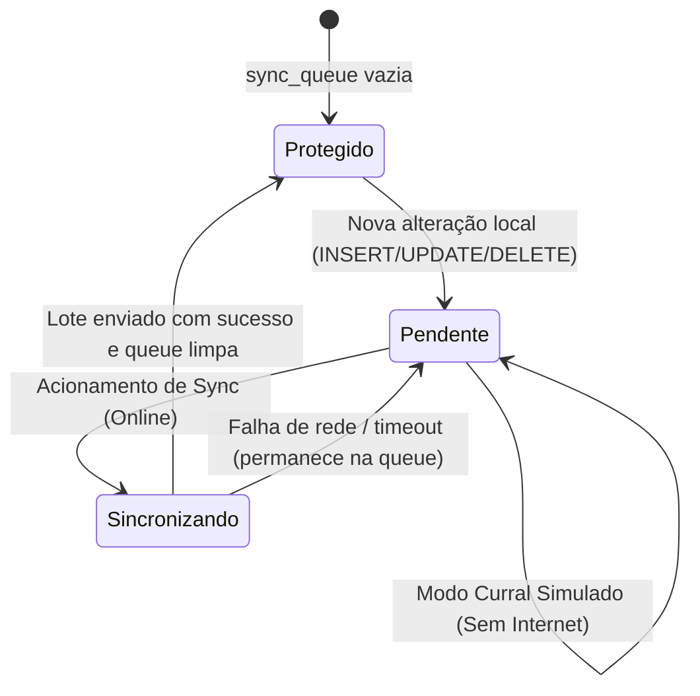

# Data Model: Fundação Offline & Infraestrutura Core

**Feature**: `000-fundacao-offline`  
**Date**: 2026-10-13  
**Status**: Ready

Este documento especifica a estrutura do banco de dados relacional SQLite gerenciado pelo Drizzle ORM para a fundação do aplicativo, incluindo as tabelas de parametrização e controle de sincronização.

---

## 1. Padrão Global de Entidades (Colunas Comuns)

Todas as tabelas de negócio do ReproLeite devem herdar o seguinte conjunto de colunas padronizadas:

| Coluna | Tipo SQLite | Nulo? | Padrão | Descrição |
| :--- | :--- | :---: | :--- | :--- |
| `id` | `TEXT` | Não | UUID v4 | Chave primária gerada no dispositivo |
| `farm_id` | `TEXT` | Não | UUID v4 | Chave de isolamento multi-tenant da fazenda |
| `created_at` | `TEXT` | Não | ISO UTC | Data e hora de criação do registro |
| `updated_at` | `TEXT` | Não | ISO UTC | Data e hora da última modificação (usado para LWW) |
| `deleted_at` | `TEXT` | Sim | `NULL` | Data e hora de exclusão lógica (soft delete) |

---

## 2. Tabelas da Fundação Core

### 2.1 Tabela `farms` (Propriedades Rurais)
Armazena a fazenda ativa e as configurações locais da propriedade.

```typescript
// Schema Drizzle representativo
export const farms = sqliteTable('farms', {
  id: text('id').primaryKey(),
  name: text('name').notNull(),
  ownerUserId: text('owner_user_id'),
  createdAt: text('created_at').notNull(),
  updatedAt: text('updated_at').notNull(),
  deletedAt: text('deleted_at'),
});
```

- **Regras**:
  - Na primeira execução do app, se não houver fazendas, o sistema inicializa automaticamente uma fazenda padrão local (ex: `"Minha Fazenda"`).

---

### 2.2 Tabela `settings` (Parâmetros da Fazenda)
Armazena preferências, prazos zootécnicos e configurações operacionais.

```typescript
export const settings = sqliteTable('settings', {
  id: text('id').primaryKey(),
  farmId: text('farm_id').notNull().references(() => farms.id),
  key: text('key').notNull(),
  value: text('value').notNull(), // JSON string ou valor textual
  createdAt: text('created_at').notNull(),
  updatedAt: text('updated_at').notNull(),
  deletedAt: text('deleted_at'),
}, (table) => ({
  farmKeyUnique: uniqueIndex('settings_farm_key_idx').on(table.farmId, table.key),
}));
```

- **Chaves Iniciais Padrão**:
  - `simulated_management_date`: Data ativa simulada (string `YYYY-MM-DD`). Se nulo, adota a data real.
  - `estrus_cycle_days`: `"21"` (janela de retorno de cio).
  - `pregnancy_check_days`: `"45"` (toque veterinário).
  - `gestation_days`: `"282"` (previsão de parto).
  - `dry_off_days_before_calving`: `"60"` (secagem da vaca).

---

### 2.3 Tabela `sync_queue` (Fila Local de Modificações Pendentes)
Fila estritamente local (não replicada na nuvem) que rastreia todas as alterações que precisam ser enviadas ao Supabase.

```typescript
export const syncQueue = sqliteTable('sync_queue', {
  id: text('id').primaryKey(),
  farmId: text('farm_id').notNull(),
  tableName: text('table_name').notNull(),
  recordId: text('record_id').notNull(),
  operation: text('operation').notNull(), // 'INSERT' | 'UPDATE' | 'DELETE'
  payloadJson: text('payload_json'),      // Snapshot serializado do registro
  attempts: integer('attempts').notNull().default(0),
  lastError: text('last_error'),
  createdAt: text('created_at').notNull(),
});
```

---

### 2.4 Tabela `sync_state` (Estado de Sincronização Local)
Registra o progresso dos cursores de sincronização.

```typescript
export const syncState = sqliteTable('sync_state', {
  id: text('id').primaryKey(),
  farmId: text('farm_id').notNull(),
  lastPulledAt: text('last_pulled_at'),
  lastPushedAt: text('last_pushed_at'),
  lastSuccessAt: text('last_success_at'),
  updatedAt: text('updated_at').notNull(),
});
```

---

## 3. Máquina de Estados da Sincronização Local



---

## 4. Validações e Regras de Integridade

1. **Datas de Calendário**: Qualquer campo de data de evento (`due_date`, `birth_date`, `date`) DEVE respeitar a máscara `YYYY-MM-DD` pura.
2. **Atomicidade de Escrita Local**: Qualquer mutação em uma tabela de dados DEVE ser encapsulada em uma transação SQLite única junto com a respectiva inserção na `sync_queue`.
3. **Consistência de Soft Delete**: Consultas de interface DEVEM incluir cláusula `WHERE deleted_at IS NULL` por padrão, exceto rotinas de diagnóstico ou restauração.
