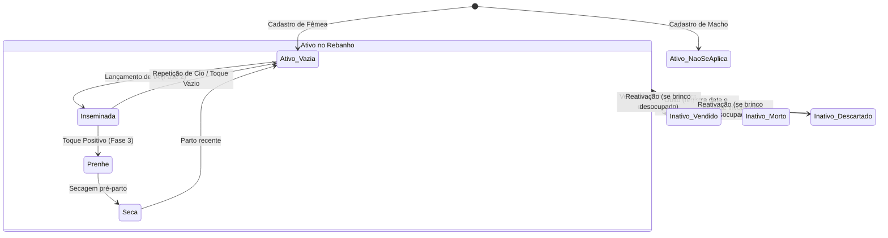

# Data Model: Rebanho & Catálogo de Touros (Feature 001)

**Feature Branch**: `001-rebanho-e-touros`  
**Date**: 2026-10-14  
**Status**: Ready for Implementation  

---

## 1. Esquema Relacional (SQLite Local & Postgres Supabase)

### Tabela: `animals` (Rebanho Bovino)
Armazena todas as fêmeas e machos (vacas, novilhas, bezerras e touros da fazenda).

| Coluna | Tipo SQLite | Nulo? | Padrão | Descrição |
| :--- | :--- | :---: | :---: | :--- |
| `id` | `TEXT` (UUID v4) | Não | - | Identificador único universal do animal |
| `farm_id` | `TEXT` (UUID v4) | Não | - | Identificador da fazenda proprietária (multi-tenant) |
| `ear_tag` | `TEXT` | Não | - | Identificador visual do brinco (ex: `"104"`) |
| `ear_tag_normalized` | `TEXT` | Não | - | Brinco normalizado sem pontuação/espaços e em maiúsculas (ex: `"104"`) |
| `name` | `TEXT` | Sim | `NULL` | Nome ou apelido do animal (ex: `"Mimosa"`) |
| `breed` | `TEXT` | Não | - | Raça (ex: `"Holandesa"`, `"Girolando"`, `"Jersey"`, `"Gir Leiteiro"`) |
| `sex` | `TEXT` | Não | `'femea'` | Sexo do animal: `'femea'` ou `'macho'` |
| `birth_date` | `TEXT` | Não | - | Data de nascimento no formato canônico `YYYY-MM-DD` |
| `birth_weight_kg` | `REAL` | Não | `40.0` | Peso de nascimento em quilogramas |
| `life_stage` | `TEXT` | Não | `'adulta'` | Estágio de vida: `'lactante'`, `'desmamada'`, `'recria'`, `'novilha_apta_ia'`, `'novilha_prenhe'`, `'adulta'` |
| `repro_status` | `TEXT` | Não | `'vazia'` | Status reprodutivo: `'vazia'`, `'inseminada'`, `'prenhe'`, `'seca'`, `'nao_se_aplica'` |
| `exit_status` | `TEXT` | Não | `'ativo'` | Condição de permanência: `'ativo'`, `'vendido'`, `'descartado'`, `'morto'` |
| `exit_date` | `TEXT` | Sim | `NULL` | Data da saída do rebanho (`YYYY-MM-DD`) |
| `exit_reason` | `TEXT` | Sim | `NULL` | Justificativa ou observações da saída do animal |
| `notes` | `TEXT` | Sim | `NULL` | Observações gerais zootécnicas |
| `created_at` | `TEXT` | Não | ISO UTC | Carimbo de data/hora de criação |
| `updated_at` | `TEXT` | Não | ISO UTC | Carimbo de data/hora da última alteração (base LWW) |
| `deleted_at` | `TEXT` | Sim | `NULL` | Marcação de exclusão lógica (soft delete) |

#### Índices e Restrições:
- **Chave Primária**: `id`
- **Índice Único Parcial de Brinco**:
  ```sql
  CREATE UNIQUE INDEX idx_animals_farm_ear_tag_active 
  ON animals (farm_id, ear_tag_normalized) 
  WHERE deleted_at IS NULL AND exit_status = 'ativo';
  ```
- **Índice de Busca e Listagem**:
  ```sql
  CREATE INDEX idx_animals_farm_status 
  ON animals (farm_id, exit_status, repro_status, deleted_at);
  ```

---

### Tabela: `bulls` (Catálogo de Touros e Estoque de Doses)
Armazena touros registrados para inseminação artificial e o saldo físico de palhetas de sêmen no botijão.

| Coluna | Tipo SQLite | Nulo? | Padrão | Descrição |
| :--- | :--- | :---: | :---: | :--- |
| `id` | `TEXT` (UUID v4) | Não | - | Identificador único universal do touro |
| `farm_id` | `TEXT` (UUID v4) | Não | - | Identificador da fazenda proprietária (multi-tenant) |
| `name` | `TEXT` | Não | - | Nome oficial ou comercial do touro (ex: `"Jaguar TE"`) |
| `breed` | `TEXT` | Não | - | Raça do touro (ex: `"Gir Leiteiro"`, `"Holandês"`) |
| `code` | `TEXT` | Sim | `NULL` | Código impresso na palheta / registro genealógico (ex: `"GIR-8821"`) |
| `straws_in_stock` | `INTEGER` | Não | `0` | Quantidade atual de doses em estoque (mínimo 0) |
| `notes` | `TEXT` | Sim | `NULL` | Observações de linhagem, PTA Leite ou recomendações |
| `created_at` | `TEXT` | Não | ISO UTC | Carimbo de criação |
| `updated_at` | `TEXT` | Não | ISO UTC | Carimbo de modificação (LWW) |
| `deleted_at` | `TEXT` | Sim | `NULL` | Soft delete |

#### Índices:
- **Chave Primária**: `id`
- **Índice por Fazenda e Atividade**:
  ```sql
  CREATE INDEX idx_bulls_farm 
  ON bulls (farm_id, deleted_at);
  ```

---

## 2. Tipos e Enums em TypeScript (`src/types/`)

```typescript
export type AnimalSex = 'femea' | 'macho';

export type AnimalLifeStage = 
  | 'lactante' 
  | 'desmamada' 
  | 'recria' 
  | 'novilha_apta_ia' 
  | 'novilha_prenhe' 
  | 'adulta';

export type AnimalReproStatus = 
  | 'vazia' 
  | 'inseminada' 
  | 'prenhe' 
  | 'seca' 
  | 'nao_se_aplica';

export type AnimalExitStatus = 
  | 'ativo' 
  | 'vendido' 
  | 'descartado' 
  | 'morto';

export interface AnimalRecord {
  id: string;
  farmId: string;
  earTag: string;
  earTagNormalized: string;
  name?: string | null;
  breed: string;
  sex: AnimalSex;
  birthDate: string; // YYYY-MM-DD
  birthWeightKg: number;
  lifeStage: AnimalLifeStage;
  reproStatus: AnimalReproStatus;
  exitStatus: AnimalExitStatus;
  exitDate?: string | null;
  exitReason?: string | null;
  notes?: string | null;
  createdAt: string;
  updatedAt: string;
  deletedAt?: string | null;
}

export interface BullRecord {
  id: string;
  farmId: string;
  name: string;
  breed: string;
  code?: string | null;
  strawsInStock: number;
  notes?: string | null;
  createdAt: string;
  updatedAt: string;
  deletedAt?: string | null;
}
```

---

## 3. Transições de Estado


