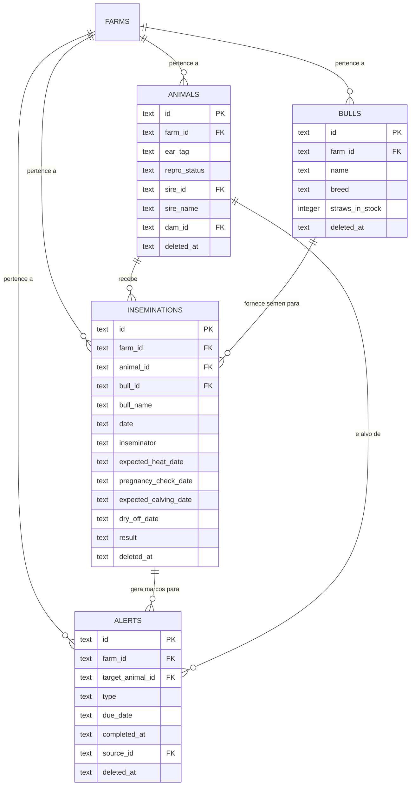
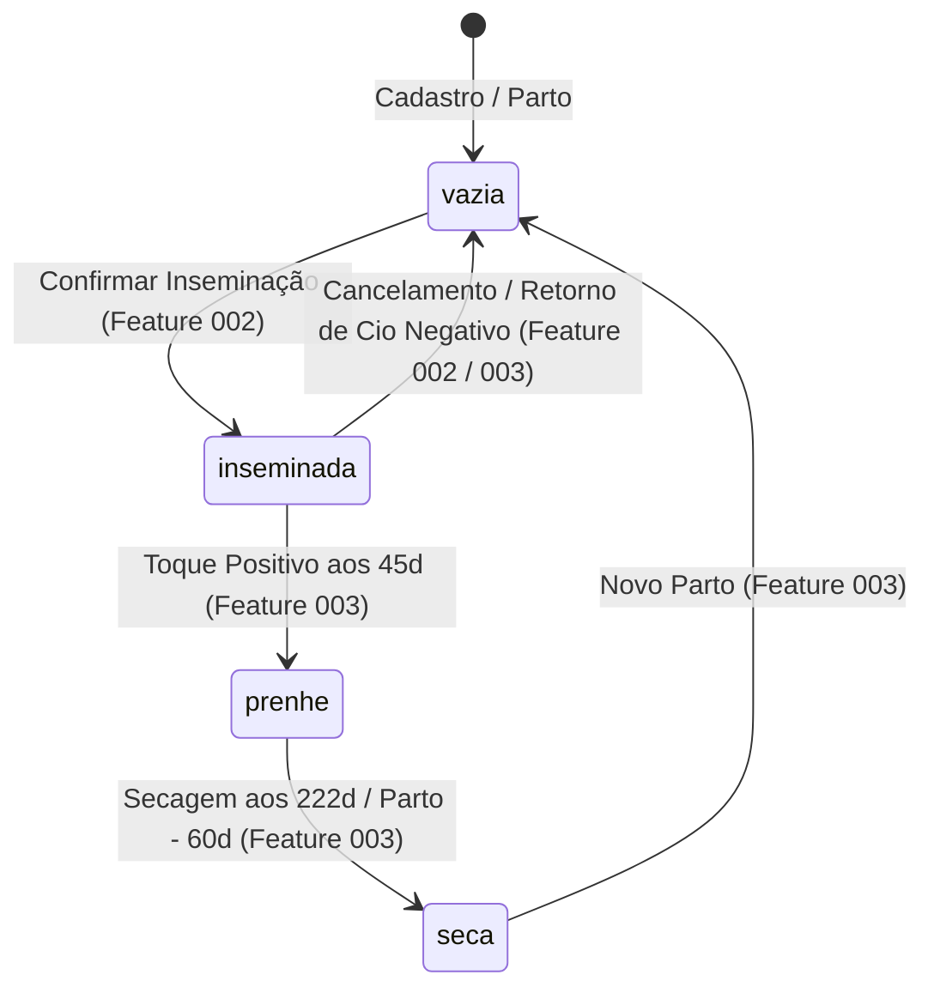

# Data Model: Inseminação Rápida, Estoque de Doses e Alertas Zootécnicos

**Feature**: `002-inseminacao-rapida`  
**Date**: 2026-10-14  

---

## 1. Esquema Relacional no SQLite Local (Drizzle ORM)

### 1.1 Tabela `inseminations` (`src/db/schema/inseminations.ts`)

Armazena cada procedimento de inseminação artificial realizado na fazenda, seus responsáveis e as datas biométricas projetadas pelo motor zootécnico.

| Coluna | Tipo SQLite | TypeScript | Nulo? | Padrão | Descrição |
|---|---|---|:---:|---|---|
| `id` | `TEXT` | `string` | Não | UUID v4 | Identificador único universal gerado no cliente |
| `farm_id` | `TEXT` | `string` | Não | — | Chave de isolamento multi-tenant (`farms.id`) |
| `animal_id` | `TEXT` | `string` | Não | — | Vaca/novilha inseminada (`animals.id`) |
| `bull_id` | `TEXT` | `string \| null` | Sim | `null` | Touro do catálogo (`bulls.id`), nulo se avulso |
| `bull_name` | `TEXT` | `string` | Não | — | Nome do touro (catalogado ou avulso) |
| `date` | `TEXT` | `string` | Não | — | Data canônica do procedimento (`YYYY-MM-DD`) |
| `inseminator` | `TEXT` | `string` | Não | — | Nome do operador/inseminador responsável |
| `expected_heat_date` | `TEXT` | `string` | Não | — | Projeção de retorno de cio (`date + 21d`) |
| `pregnancy_check_date` | `TEXT` | `string` | Não | — | Projeção do exame de toque (`date + 45d`) |
| `expected_calving_date` | `TEXT` | `string` | Não | — | Projeção do parto (`date + 282d`) |
| `dry_off_date` | `TEXT` | `string` | Não | — | Projeção da secagem (`calving - 60d`) |
| `result` | `TEXT` | `'pendente' \| 'prenhe' \| 'vazia'` | Não | `'pendente'` | Desfecho reprodutivo |
| `notes` | `TEXT` | `string \| null` | Sim | `null` | Observações operacionais |
| `created_at` | `TEXT` | `string` | Não | UTC ISO | Data/hora de criação do registro |
| `updated_at` | `TEXT` | `string` | Não | UTC ISO | Data/hora da última atualização (LWW) |
| `deleted_at` | `TEXT` | `string \| null` | Sim | `null` | Tombstone para exclusão lógica e sync |

**Índices no SQLite**:
- `idx_inseminations_farm`: `(farm_id, deleted_at)`
- `idx_inseminations_animal`: `(animal_id, date, deleted_at)`

---

### 1.2 Tabela `alerts` (`src/db/schema/alerts.ts`)

Armazena os compromissos zootécnicos gerados automaticamente para orientar o painel diário de manejo ("Hoje no Curral").

| Coluna | Tipo SQLite | TypeScript | Nulo? | Padrão | Descrição |
|---|---|---|:---:|---|---|
| `id` | `TEXT` | `string` | Não | UUID v4 | Identificador único universal |
| `farm_id` | `TEXT` | `string` | Não | — | Isolamento multi-tenant (`farms.id`) |
| `target_animal_id` | `TEXT` | `string` | Não | — | Animal alvo do alerta (`animals.id`) |
| `type` | `TEXT` | `AlertType` | Não | — | Tipo do alerta (ver abaixo) |
| `due_date` | `TEXT` | `string` | Não | — | Data canônica de vencimento (`YYYY-MM-DD`) |
| `completed_at` | `TEXT` | `string \| null` | Sim | `null` | Data/hora em que a ação foi cumprida/baixada |
| `source_id` | `TEXT` | `string \| null` | Sim | `null` | Vínculo de origem (`inseminations.id`) |
| `notes` | `TEXT` | `string \| null` | Sim | `null` | Informações complementares |
| `created_at` | `TEXT` | `string` | Não | UTC ISO | Timestamp de auditoria |
| `updated_at` | `TEXT` | `string` | Não | UTC ISO | Timestamp de auditoria |
| `deleted_at` | `TEXT` | `string \| null` | Sim | `null` | Tombstone para exclusão lógica |

**Tipos de Alerta (`AlertType`)**:
- `'heat_check_21d'`: Vigia de retorno de cio (21 dias pós-IA).
- `'pregnancy_check_45d'`: Exame de toque / palpação veterinária (45 dias pós-IA).
- `'calving_due'`: Previsão de parto (282 dias pós-IA).
- `'dry_off'`: Secagem obrigatória da vaca (60 dias antes do parto).

**Índices no SQLite**:
- `idx_alerts_farm_due`: `(farm_id, due_date, completed_at, deleted_at)`
- `idx_alerts_source`: `(source_id, deleted_at)`

---

### 1.3 Atualização na Tabela `animals` (`src/db/schema/animals.ts`)

Para suportar a verificação de consanguinidade genealógica de 1º e 2º grau com reprodutores cadastrados ou avulsos, adicionam-se colunas de filiação à tabela de animais:

- `sire_id` (`TEXT`, nulo): Chave do touro pai cadastrado em `bulls`.
- `sire_name` (`TEXT`, nulo): Nome descritivo do pai para consultas de consanguinidade.
- `dam_id` (`TEXT`, nulo): Chave da mãe cadastrada em `animals`.
- `dam_name` (`TEXT`, nulo): Nome descritivo da mãe.
- `maternal_grandsire_name` (`TEXT`, nulo): Nome do avô materno (pai da mãe).
- `paternal_grandsire_name` (`TEXT`, nulo): Nome do avô paterno (pai do pai).

---

## 2. Diagrama de Relacionamentos (ERD)

---

## 3. Máquina de Estados Reprodutivos da Fêmea

