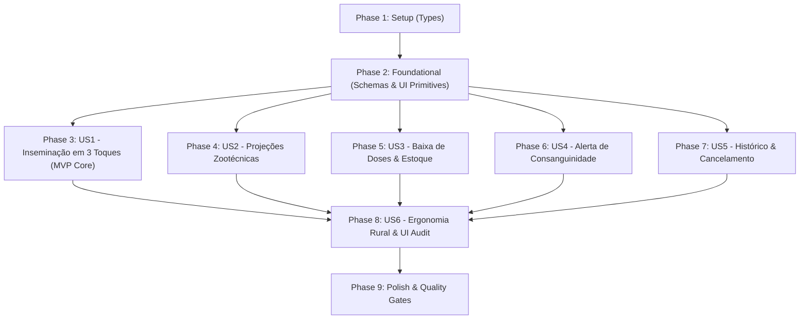

# Tasks: Inseminação Rápida no Curral com Baixa de Doses, Projeções Reprodutivas e Alerta de Consanguinidade

**Branch**: `002-inseminacao-rapida`  
**Feature Spec**: [spec.md](file:///c:/DEV/github/repro-leite/specs/002-inseminacao-rapida/spec.md)  
**Implementation Plan**: [plan.md](file:///c:/DEV/github/repro-leite/specs/002-inseminacao-rapida/plan.md)  
**Data Model**: [data-model.md](file:///c:/DEV/github/repro-leite/specs/002-inseminacao-rapida/data-model.md)  
**Quickstart**: [quickstart.md](file:///c:/DEV/github/repro-leite/specs/002-inseminacao-rapida/quickstart.md)  

---

## Phase 1: Setup (Shared Types & Data Contracts)

**Purpose**: Definição das interfaces TypeScript, DTOs e tipos de domínio compartilhados para Inseminação, Alertas e Filiação Genealógica.

- [x] T001 Define insemination TypeScript types, DTOs and milestones interfaces (`InseminationRecord`, `CreateInseminationDTO`, `InseminationMilestones`, `ConsanguinityCheckResult`) in `src/types/insemination.ts`
- [x] T002 [P] Define alert TypeScript types and enums (`AlertType`, `AlertRecord`, `CreateAlertDTO`) in `src/types/alert.ts`
- [x] T003 [P] Add optional pedigree fields (`sireId`, `sireName`, `damId`, `damName`, `maternalGrandsireName`, `paternalGrandsireName`) to animal types in `src/types/animal.ts`

---

## Phase 2: Foundational (Blocking Prerequisites: SQLite Schemas & UI Primitives)

**Purpose**: Esquemas SQLite locais via Drizzle ORM e as 4 novas primitivas de interface do design system em `src/ui/`.

**⚠️ CRITICAL**: Nenhuma tarefa de interface de usuário ou caso de uso pode iniciar antes da conclusão desta fase.

- [x] T004 Create Drizzle SQLite schema for `inseminations` table with indices on `(farm_id, deleted_at)` and `(animal_id, date, deleted_at)` in `src/db/schema/inseminations.ts`
- [x] T005 [P] Create Drizzle SQLite schema for `alerts` table with indices on `(farm_id, due_date, completed_at, deleted_at)` and `(source_id, deleted_at)` in `src/db/schema/alerts.ts`
- [x] T006 Update `animals` Drizzle schema with nullable pedigree columns (`sire_id`, `sire_name`, `dam_id`, `dam_name`, `maternal_grandsire_name`, `paternal_grandsire_name`) in `src/db/schema/animals.ts`
- [x] T007 Export `inseminations` and `alerts` schemas in `src/db/schema/index.ts` and register in `src/db/client.ts`
- [x] T008 [P] Implement reusable `BannerAlerta` component with high contrast, semantic color variants ('atencao', 'alerta', 'sucesso', 'info') and touch action in `src/ui/BannerAlerta.tsx`
- [x] T009 [P] Implement reusable `PainelProjecaoZootecnica` component displaying 4 milestone cards (cio 21d, toque 45d, parto 282d, secagem -60d) with relative day badges in `src/ui/PainelProjecaoZootecnica.tsx`
- [x] T010 [P] Implement reusable `SeletorItemModal` component with instant search, numeric keypad option, status filter pills, and 56px touch targets in `src/ui/SeletorItemModal.tsx`
- [x] T011 [P] Implement reusable `BadgeEstoqueDoses` component with semantic availability indicators (green >3, amber 1-3, red 0) in `src/ui/BadgeEstoqueDoses.tsx`
- [x] T012 Re-export all new primitives in `src/ui/index.ts`

**Checkpoint**: Fundação completa - esquemas SQLite e componentes UI primitivos compilando sem erros.

---

## Phase 3: User Story 1 - Inseminação em 3 Toques no Curral (Priority: P1) 🎯 MVP Core

**Goal**: Permitir que o operador lance uma inseminação artificial completa no curral em menos de 30 segundos com 3 toques principais (seleção de fêmea, reprodutor e confirmação), com opção sequencial "Confirmar e Inseminar Outra".

**Independent Test**: Selecionar vaca vazia por busca rápida de brinco, selecionar touro com saldo de doses, tocar em "Confirmar e Concluir"; a vaca passa a "Inseminada", o evento é gravado no SQLite e o formulário é limpo.

### Tests for User Story 1
> **NOTE: Write these tests FIRST, ensure they FAIL before implementation**

- [x] T013 [P] [US1] Create unit tests for pure reproduction domain engine (`calculateReproductiveMilestones`) in `__tests__/domain/reproduction.test.ts`

### Implementation for User Story 1

- [x] T014 [US1] Implement pure domain function `calculateReproductiveMilestones` with canonical `YYYY-MM-DD` date offsets in `src/domain/reproduction.ts`
- [x] T015 [US1] Implement `InseminationRepository.createInsemination` with atomic animal status update, straw stock decrement, alert creation, and `sync_queue` enqueueing in `src/db/repositories/inseminationRepository.ts`
- [x] T016 [US1] Implement `FormularioInseminacaoRapida` component with cow picker, bull selector, simulator date integration, inseminator memory, and action buttons ("Confirmar e Concluir", "Confirmar e Inseminar Outra") in `src/components/inseminacao/FormularioInseminacaoRapida.tsx`
- [x] T017 [US1] Integrate "Inseminar" section in `src/app/(tabs)/reproducao.tsx` and add direct "Inseminar" shortcut button on apt cow cards in the herd list

**Checkpoint**: Fluxo de Inseminação em 3 toques e fluxo sequencial funcionais e testáveis de forma independente no dispositivo.

---

## Phase 4: User Story 2 - Painel de Projeções Zootécnicas Imediatas (Priority: P1)

**Goal**: Exibir em tempo real no formulário de IA o cálculo das 4 datas zootécnicas (+21d retorno do cio, +45d toque veterinário, +282d parto previsto, -60d secagem) e persistir os alertas automáticos correspondentes.

**Independent Test**: Alterar a data do procedimento no formulário e verificar que os cartões do `PainelProjecaoZootecnica` recalculam instantaneamente, e após salvar verificar que os registros de alerta estão na tabela `alerts`.

### Implementation for User Story 2

- [x] T018 [US2] Implement `AlertRepository` (`listPendingByFarm`, `create`, `completeAlert`, `softDeleteBySourceId`) with `sync_queue` integration in `src/db/repositories/alertRepository.ts`
- [x] T019 [US2] Connect dynamic milestone recalculation to date changes using `PainelProjecaoZootecnica` inside `src/components/inseminacao/FormularioInseminacaoRapida.tsx`
- [x] T020 [US2] Ensure alerts for 21d heat check and 45d pregnancy check are automatically scheduled with canonical dates upon saving in `src/db/repositories/inseminationRepository.ts`

**Checkpoint**: Projeções reprodutivas visíveis em tempo real e compromissos gravados na tabela `alerts`.

---

## Phase 5: User Story 3 - Baixa Automática e Controle de Estoque de Palhetas de Sêmen (Priority: P1)

**Goal**: Debitar 1 dose do touro catalogado no momento da confirmação, alertar caso o saldo esteja zerado permitindo abastecimento rápido via modal sem perder a seleção, e suportar digitação de touro avulso.

**Independent Test**: Inseminar com touro de 5 doses (reduz para 4); tentar com touro de 0 doses e verificar o modal de aviso com atalho "+ Adicionar Doses" que atualiza o estoque na hora.

### Implementation for User Story 3

- [x] T021 [US3] Implement quick straw restocking modal (`ModalAbastecimentoDoses`) using `CampoNumerico` and 56px touch buttons in `src/components/inseminacao/ModalAbastecimentoDoses.tsx`
- [x] T022 [US3] Add zero-stock detection and modal trigger with "+ Adicionar Doses" shortcut in `src/components/inseminacao/FormularioInseminacaoRapida.tsx`
- [x] T023 [US3] Support uncataloged/free-form bull entry without straw deduction in `FormularioInseminacaoRapida.tsx` and `InseminationRepository.ts`

**Checkpoint**: Controle atômico de doses de sêmen, tratamento de estoque zerado e touro avulso 100% integrados.

---

## Phase 6: User Story 4 - Alerta Visual de Consanguinidade e Prevenção de Endogamia (Priority: P2)

**Goal**: Alertar preventivamente o inseminador em destaque amarelo caso o touro escolhido seja pai (1º grau) ou avô (2º grau) da fêmea receptora, prevenindo acasalamentos consanguíneos indesejados.

**Independent Test**: Selecionar uma novilha cujo pai cadastrado é "Touro A", selecionar "Touro A" e verificar a aparição imediata do `BannerAlerta` âmbar com aviso de consanguinidade de 1º grau.

### Tests for User Story 4
> **NOTE: Write these tests FIRST, ensure they FAIL before implementation**

- [x] T024 [P] [US4] Create unit tests for consanguinity engine (`checkConsanguinity`) covering sire match (1st degree) and maternal/paternal grandsire match (2nd degree) in `__tests__/domain/consanguinity.test.ts`

### Implementation for User Story 4

- [x] T025 [US4] Implement pure domain function `checkConsanguinity` evaluating pedigree matching by ID and normalized name in `src/domain/consanguinity.ts`
- [x] T026 [US4] Integrate consanguinity detection with `BannerAlerta` in `FormularioInseminacaoRapida.tsx`, requiring explicit user acknowledgment ("Prosseguir mesmo assim") before confirming

**Checkpoint**: Detecção determinística e alerta de consanguinidade em tempo real ativos na tela de IA.

---

## Phase 7: User Story 5 - Histórico Recente e Cancelamento com Estorno de Dose (Priority: P2)

**Goal**: Exibir as últimas inseminações do dia e disponibilizar cancelamento/exclusão de lançamentos errôneos, com estorno opcional de dose ao botijão e restauração inteligente do status da vaca com base no histórico.

**Independent Test**: Excluir uma inseminação recente com estorno de dose; o saldo do touro sobe em 1 dose, os alertas atrelados são cancelados e a vaca volta a ser "Vazia" (ou mantém "Inseminada" se houver IA anterior ativa).

### Tests for User Story 5
> **NOTE: Write these tests FIRST, ensure they FAIL before implementation**

- [x] T027 [P] [US5] Create unit tests for intelligent status restoration (`resolveAnimalReproStatusAfterCancellation`) in `__tests__/domain/reproduction.test.ts`

### Implementation for User Story 5

- [x] T028 [US5] Implement pure domain logic `resolveAnimalReproStatusAfterCancellation` evaluating remaining active history in `src/domain/reproduction.ts`
- [x] T029 [US5] Implement `InseminationRepository.listRecentByFarm` and `InseminationRepository.deleteInsemination` with atomic soft-delete, alert cancellation, straw restore, and status recalculation in `src/db/repositories/inseminationRepository.ts`
- [x] T030 [US5] Implement `HistoricoInseminacoesRecentes` component with list of recent IAs and deletion/restoration modal in `src/components/inseminacao/HistoricoInseminacoesRecentes.tsx` and integrate into `src/app/(tabs)/reproducao.tsx`

**Checkpoint**: Histórico recente e cancelamento seguro com estorno de doses 100% testados e integrados.

---

## Phase 8: User Story 6 - Componentização Reutilizável para Ergonomia Rural (`src/ui`) (Priority: P2)

**Goal**: Assegurar que toda a experiência visual da Feature 002 e das telas conectadas consuma estritamente os componentes de `src/ui/` com alvos de toque $\ge 48/56\text{ px}$ e contraste de alto sol.

**Independent Test**: Inspecionar que nenhum botão ou controle interativo na seção de Inseminação utiliza classes soltas ou concatenadas dinamicamente, mantendo conformidade com a Constituição.

### Implementation for User Story 6

- [x] T031 [US6] Audit and refactor `src/components/inseminacao/` to ensure all buttons use `Botao` (min-h-14 / min-h-12), inputs use `CampoNumerico`/`CampoTexto`, and cards use `Cartao`
- [x] T032 [US6] Ensure all dialogs and selectors use `ModalPadrao`, `SeletorItemModal` and `BannerAlerta` with static NativeWind classes

**Checkpoint**: Padronização visual e ergonomia rural 100% conforme à Constituição ReproLeite.

---

## Phase 9: Polish & Cross-Cutting Concerns

**Purpose**: Verificação rigorosa de qualidade, testes integrados de ponta a ponta, compilação TypeScript e conformidade com linter.

- [x] T033 [P] Execute all unit tests with `npm test` and verify 100% pass across `reproduction.test.ts`, `consanguinity.test.ts`, and repository tests
- [x] T034 Run TypeScript typecheck with `npx tsc --noEmit` and verify 0 type errors
- [x] T035 Run Expo linter with `npx expo lint` and verify 0 warnings or errors
- [x] T036 Execute manual quickstart validation walkthrough per `specs/002-inseminacao-rapida/quickstart.md`

---

## Dependencies & Execution Order

### Phase Dependencies

### Parallel Opportunities

- **Phase 1**: T001, T002 e T003 podem ser executadas em paralelo (arquivos separados).
- **Phase 2**: T005, T008, T009, T010, T011 podem ser criadas em paralelo (esquemas e componentes visuais desacoplados).
- **Phase 3 a 7**:
  - Testes T013 (US1), T024 (US4), T027 (US5) podem ser escritos em paralelo no Jest.
  - Motores de domínio `reproduction.ts` e `consanguinity.ts` podem ser desenvolvidos de forma independente.
- **Phase 9**: T033, T034 e T035 podem rodar em paralelo.

---

## Implementation Strategy

### MVP First (Phases 1, 2 e 3)
1. Concluir Setup (Tipos) e Fundação (Schemas SQLite e Primitivas de UI).
2. Concluir Phase 3 (User Story 1 - Inseminação em 3 toques no curral).
3. **Validar MVP**: Lançar IA no curral, debitar estoque e verificar atualização do animal para "Inseminada".

### Entrega Incremental
1. MVP entregue $\rightarrow$ Adicionar Projeções Zootécnicas em tempo real (US2).
2. Adicionar controle de estoque zerado e abastecimento rápido (US3).
3. Adicionar alerta preventivo de consanguinidade pai/avô (US4).
4. Adicionar histórico recente e cancelamento com estorno (US5).
5. Auditoria de ergonomia rural em `src/ui/` e Quality Gates finais (US6 + Phase 9).
