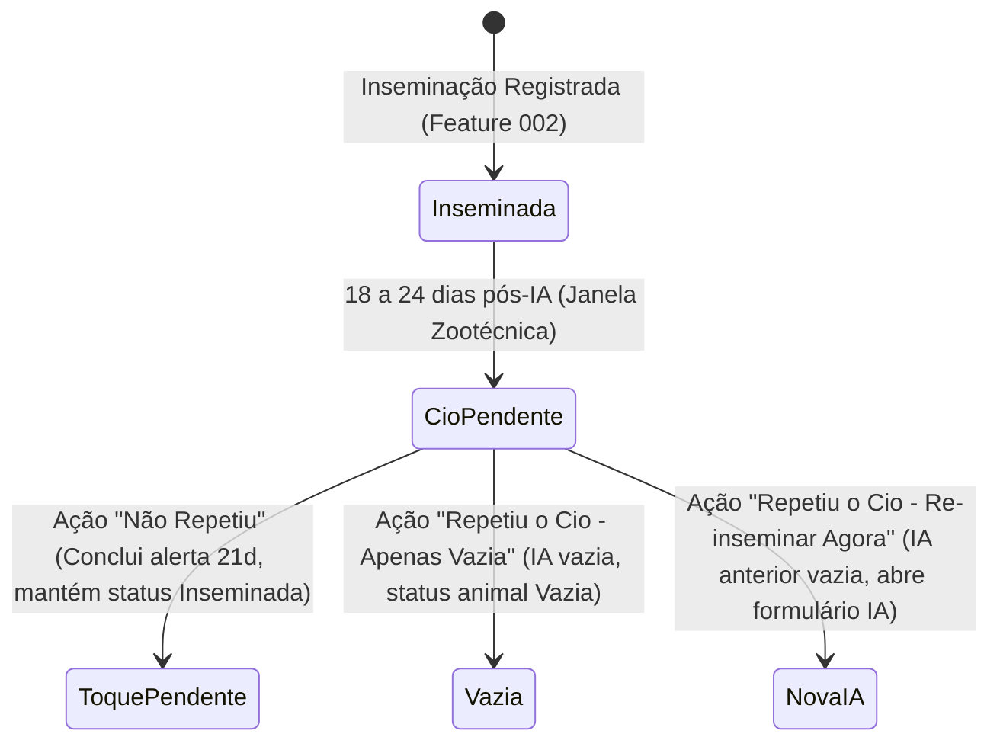
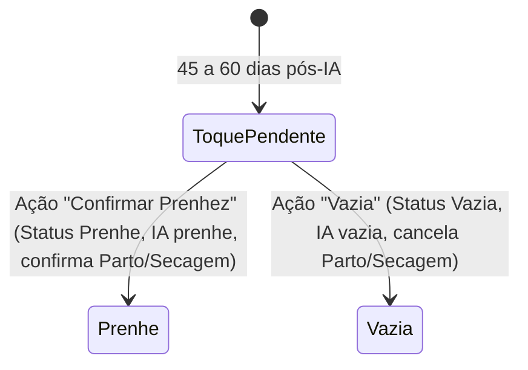

# Data Model: 003-hoje-no-curral

**Feature**: Hoje no Curral (Painel Diário de Decisões, Monitoramento de Cios, Toques Veterinários e Trato de Bezerras)  
**Date**: 2026-10-14  
**Status**: Completed (Phase 1)

---

## 1. Entidades Existentes Utilizadas

### 1.1 `alerts` (Tabela SQLite e Entidade de Domínio)
Armazena os marcos zootécnicos e alertas pendentes de resolução no curral.

| Campo | Tipo SQLite | Tipo TypeScript | Descrição |
| :--- | :--- | :--- | :--- |
| `id` | `TEXT PRIMARY KEY` | `string` (UUID v7) | Identificador único do alerta |
| `farm_id` | `TEXT NOT NULL` | `string` (UUID v7) | Chave de isolamento multi-tenant da fazenda |
| `target_animal_id`| `TEXT NOT NULL` | `string` (UUID v7) | Vínculo com a fêmea (`animals.id`) |
| `type` | `TEXT NOT NULL` | `AlertType` | `'heat_check_21d'` \| `'pregnancy_check_45d'` \| `'calving_due'` \| `'dry_off'` |
| `due_date` | `TEXT NOT NULL` | `string` (YYYY-MM-DD) | Data de vencimento zootécnico do marco |
| `completed_at` | `TEXT` | `string \| null` (ISO UTC) | Timestamp de conclusão do manejo no curral |
| `source_id` | `TEXT` | `string \| null` | Vínculo com a inseminação de origem (`inseminations.id`) |
| `notes` | `TEXT` | `string \| null` | Observações operacionais |
| `created_at` | `TEXT NOT NULL` | `string` (ISO UTC) | Data de criação |
| `updated_at` | `TEXT NOT NULL` | `string` (ISO UTC) | Data da última alteração |
| `deleted_at` | `TEXT` | `string \| null` | Tombstone para soft delete |

### 1.2 `inseminations` (Tabela SQLite e Entidade de Domínio)
Armazena os procedimentos reprodutivos e o resultado final da IA.

| Campo | Tipo SQLite | Tipo TypeScript | Descrição |
| :--- | :--- | :--- | :--- |
| `id` | `TEXT PRIMARY KEY` | `string` (UUID v7) | Identificador único da IA |
| `farm_id` | `TEXT NOT NULL` | `string` (UUID v7) | Chave da fazenda |
| `animal_id` | `TEXT NOT NULL` | `string` (UUID v7) | ID da vaca |
| `bull_id` | `TEXT` | `string \| null` | ID do touro cadastrado (se houver) |
| `bull_name` | `TEXT NOT NULL` | `string` | Nome do touro |
| `date` | `TEXT NOT NULL` | `string` (YYYY-MM-DD) | Data da realização da IA |
| `inseminator` | `TEXT NOT NULL` | `string` | Inseminador responsável |
| `expected_heat_date` | `TEXT NOT NULL` | `string` (YYYY-MM-DD) | Data de retorno do cio (+21 dias) |
| `pregnancy_check_date`| `TEXT NOT NULL` | `string` (YYYY-MM-DD) | Data do toque veterinário (+45 dias) |
| `expected_calving_date`| `TEXT NOT NULL` | `string` (YYYY-MM-DD) | Data prevista de parto (+282 dias) |
| `dry_off_date` | `TEXT NOT NULL` | `string` (YYYY-MM-DD) | Data prevista de secagem (+222 dias) |
| `result` | `TEXT NOT NULL` | `InseminationResult` | `'pendente'` \| `'prenhe'` \| `'vazia'` |

### 1.3 `animals` (Tabela SQLite e Entidade de Domínio)
Representa o animal no rebanho.

| Campo | Tipo SQLite | Tipo TypeScript | Descrição |
| :--- | :--- | :--- | :--- |
| `id` | `TEXT PRIMARY KEY` | `string` (UUID v7) | Identificador único do animal |
| `farm_id` | `TEXT NOT NULL` | `string` (UUID v7) | Chave da fazenda |
| `ear_tag` | `TEXT NOT NULL` | `string` | Número visual do brinco |
| `name` | `TEXT` | `string \| null` | Nome / apelido do animal |
| `sex` | `TEXT NOT NULL` | `'femea' \| 'macho'` | Sexo do animal |
| `birth_date` | `TEXT NOT NULL` | `string` (YYYY-MM-DD) | Data de nascimento |
| `life_stage` | `TEXT NOT NULL` | `AnimalLifeStage` | Estágio de vida (`lactante`, `desmamada`, `recria`, etc.) |
| `repro_status` | `TEXT NOT NULL` | `AnimalReproStatus` | `'vazia'` \| `'inseminada'` \| `'prenhe'` \| `'seca'` |
| `exit_status` | `TEXT NOT NULL` | `AnimalExitStatus` | `'ativo'` \| `'vendido'` \| `'descartado'` \| `'morto'` |

---

## 2. Modelos Derivados de Domínio (In-Memory)

### 2.1 `AlertWithReproDetails`
Enriquecimento do alerta para exibição nos cartões de decisão do "Hoje no Curral":

```typescript
export interface AlertWithReproDetails extends AlertRecord {
  animalEarTag: string;
  animalName?: string | null;
  bullName?: string | null;
  inseminationDate?: string | null;
  daysSinceInsemination?: number;
  isOverdue: boolean;
}
```

### 2.2 `CalfFeedingSummary`
Consolidação nutricional diária calculada a partir das bezerras ativas e da data ativa de manejo:

```typescript
export interface CalfTransitionItem {
  animalId: string;
  earTag: string;
  name?: string | null;
  ageInDays: number;
  stage: 'inicial' | 'pico' | 'desmame' | 'desmamada';
  phaseName: string;
  morningLiters: number;
  afternoonLiters: number;
  nextStepDays?: number; // Dias até a próxima transição ou corte
  nextStepDescription?: string;
}

export interface CalfFeedingSummary {
  totalMorningLiters: number;
  totalAfternoonLiters: number;
  totalDailyLiters: number;
  activeCalvesCount: number;
  weaningCount: number; // Bezerras na fase de corte gradual (101-121d)
  transitioningCalves: CalfTransitionItem[];
}
```

---

## 3. Máquinas de Estados e Transições

### 3.1 Transições do Alerta de Cio (21 dias)



### 3.2 Transições do Diagnóstico de Gestação (45 a 60 dias)



### 3.3 Regras de Integridade e Transações Atômicas
Toda transição de estado que altera `inseminations`, `animals` e `alerts` é executada de forma estritamente atômica via `DrizzleTransactionRunner` (`withTransaction`), gerando concomitantemente as mutações na fila de outbox (`sync_queue`).
