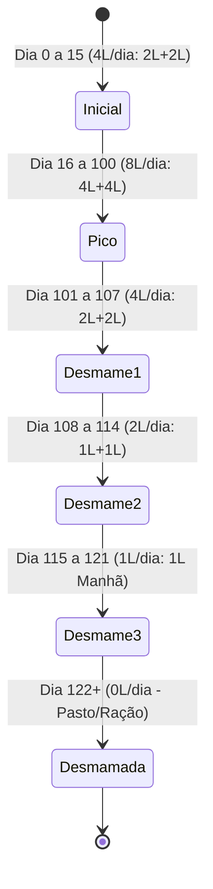
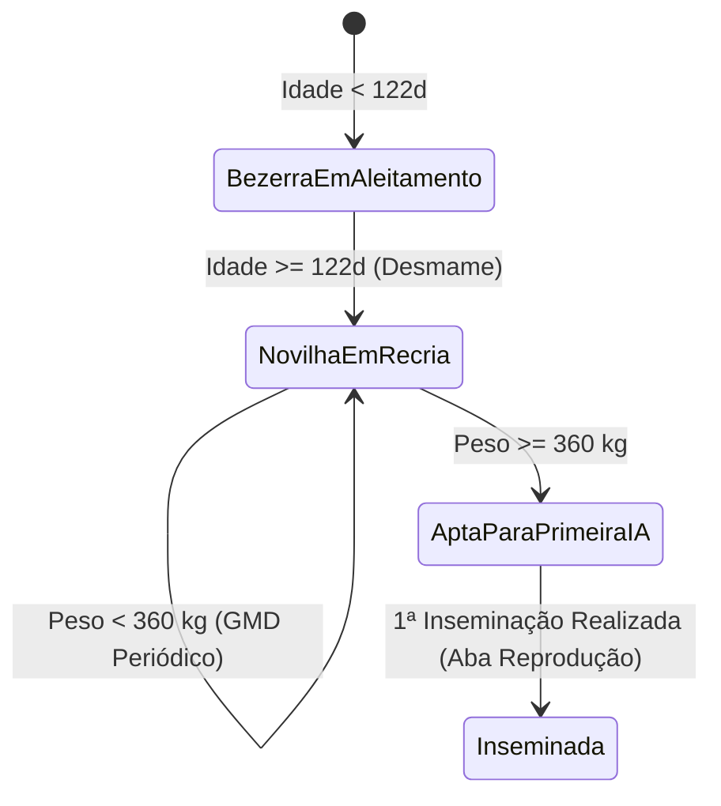

# Data Model: 004-bezerras-aleitamento-recria

**Feature Branch**: `feature/004-bezerras-aleitamento-recria`  
**Date**: 2026-10-14  
**Context**: Modelos relacionais no SQLite, entidades de domínio puro e máquinas de estado zootécnicas para o módulo de Bezerras e Recria.

---

## 1. Esquema Relacional SQLite (Drizzle ORM)

### Tabela `weighings` (Pesagens de Bezerras e Novilhas)
```ts
export const weighings = sqliteTable(
  'weighings',
  {
    id: text('id').primaryKey(), // UUID v4 / v7 gerado no cliente
    farmId: text('farm_id')
      .notNull()
      .references(() => farms.id),
    animalId: text('animal_id')
      .notNull()
      .references(() => animals.id),
    date: text('date').notNull(), // ISO YYYY-MM-DD
    weightKg: real('weight_kg').notNull(),
    notes: text('notes'),
    createdAt: text('created_at').notNull(), // ISO UTC
    updatedAt: text('updated_at').notNull(), // ISO UTC
    deletedAt: text('deleted_at'), // Soft delete
  },
  (table) => [
    index('idx_weighings_animal_date').on(table.animalId, table.date),
    index('idx_weighings_farm_deleted').on(table.farmId, table.deletedAt),
  ]
);
```

### Extensão do Registro de `animals`
O schema existente `animals` já contém:
- `id`: UUID
- `farmId`: UUID da fazenda
- `earTag`: Brinco visível
- `earTagNormalized`: Brinco normalizado para busca única
- `name`: Nome da bezerra/novilha
- `breed`: Raça
- `sex`: `'femea'` ou `'macho'`
- `birthDate`: ISO `YYYY-MM-DD`
- `birthWeightKg`: Peso de nascimento em kg (padrão 40,0 kg)
- `lifeStage`: `'bezerra'` | `'novilha'` | `'adulta'`
- `reproStatus`: `'vazia'` | `'inseminada'` | `'prenhe'` | `'seca'`
- `sireId`: ID do touro (catálogo de touros)
- `sireName`: Nome do touro
- `damId`: ID da mãe (rebanho de vacas)
- `damName`: Nome da mãe
- `maternalGrandsireName`: Nome da Avó Materna (ou avô materno / linhagem)
- `notes`: Observações gerais

---

## 2. Entidades de Domínio Puro & DTOs

### `CalfFeedingPlan`
```ts
export type FeedingStage =
  | 'inicial'
  | 'pico'
  | 'desmame_semana1'
  | 'desmame_semana2'
  | 'desmame_semana3'
  | 'desmamada';

export interface CalfFeedingPlan {
  stage: FeedingStage;
  phaseName: string; // "Fase Inicial (Adaptação)", "Pico de Aleitamento", etc.
  ageInDays: number;
  ageInMonths: number;
  morningLiters: number;
  afternoonLiters: number;
  totalDailyLiters: number;
  badgeLabel: string; // "4L/dia", "8L/dia", "2L/dia", "1L/dia", "0L/dia"
  badgeVariant: 'prenhe' | 'inseminada' | 'aviso' | 'secada';
  daysUntilNextChange: number;
  nextChangeDate?: string; // YYYY-MM-DD
}
```

### `WeaningMilestone`
```ts
export interface WeaningMilestone {
  dayNumber: number; // 1, 16, 101, 108, 115, 122
  date: string; // YYYY-MM-DD
  title: string; // "Nascimento & Colostro", "Pico de Aleitamento", etc.
  description: string; // "Ingestão de colostro...", etc.
  litersDescription: string; // "4L/dia", "8L/dia", "Desmamada"
  isCurrent: boolean;
  isPast: boolean;
}
```

### `GrowthMetrics`
```ts
export interface GrowthMetrics {
  currentWeightKg: number;
  birthWeightKg: number;
  totalWeightGainKg: number;
  dailyGainGramsPerDay: number; // GMD do último período (g/dia)
  cumulativeDailyGainGramsPerDay: number; // GMD desde o nascimento
  targetFirstBreedingWeightKg: number; // Padrão: 360 kg
  remainingKgToTarget: number;
  progressPercentToTarget: number; // 0 a 100%
  isReadyForBreeding: boolean; // true se >= 360 kg e fêmea
  lastWeighingDate: string;
}
```

### `CalfWithDetails` (View Model da Ficha Completa)
```ts
export interface CalfWithDetails {
  id: string;
  farmId: string;
  earTag: string;
  name?: string | null;
  sex: 'femea' | 'macho';
  breed: string;
  birthDate: string;
  birthWeightKg: number;
  lifeStage: 'bezerra' | 'novilha';
  reproStatus: string;
  // Genealogia
  sireId?: string | null;
  sireName?: string | null;
  damId?: string | null;
  damName?: string | null;
  maternalGranddamName?: string | null;
  // Cálculos zootécnicos dinâmicos
  feedingPlan: CalfFeedingPlan;
  weaningTimeline: WeaningMilestone[];
  growthMetrics?: GrowthMetrics;
  weighingsHistory: WeighingRecord[];
}
```

---

## 3. Máquinas de Estado Zootécnicas

### Ciclo de Nutrição Líquida (Aleitamento)


### Ciclo de Desenvolvimento Corporal (Recria & 1ª IA)


---

## 4. Regras de Validação de Dados

1. **Unicidade de Brinco**: O número do brinco deve ser único entre os animais ativos da fazenda (`deleted_at IS NULL AND exit_status = 'ativo'`).
2. **Data de Nascimento**: Obrigatória, formato `YYYY-MM-DD`, não pode ser futura em relação à data ativa do sistema.
3. **Peso de Nascimento**: Numérico positivo ($20,0 \le \text{peso} \le 70,0$ kg). Padrão caso não informado: $40,0$ kg.
4. **Data de Pesagem**: Obrigatória, formato `YYYY-MM-DD`, não pode ser anterior à data de nascimento do animal.
5. **Peso na Pesagem**: Numérico positivo ($20,0 \le \text{peso} \le 900,0$ kg).
6. **Sexo**: Apenas `'femea'` ou `'macho'`. Machos não recebem meta nem botão para 1ª IA.
