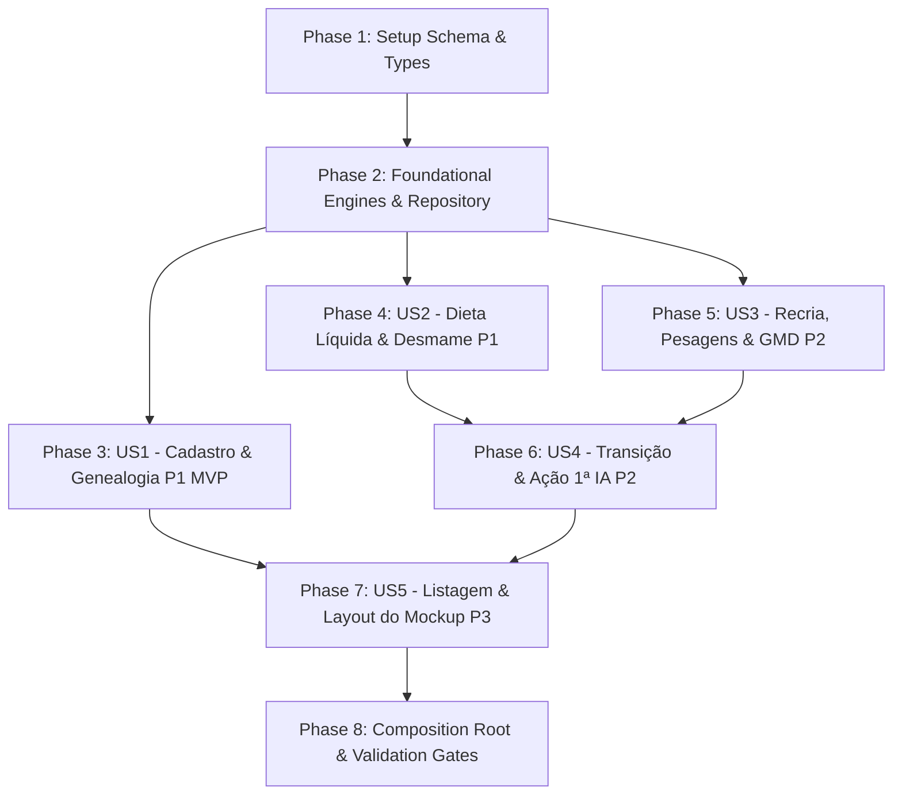

# Tasks: 004-bezerras-aleitamento-recria (Aba Bezerras: Genealogia em 3 Níveis, Curva de Leite & Recria)

**Branch**: `feature/004-bezerras-aleitamento-recria`  
**Feature Spec**: [spec.md](file:///c:/DEV/github/repro-leite/specs/004-bezerras-aleitamento-recria/spec.md)  
**Implementation Plan**: [plan.md](file:///c:/DEV/github/repro-leite/specs/004-bezerras-aleitamento-recria/plan.md)  
**Research & Decisions**: [research.md](file:///c:/DEV/github/repro-leite/specs/004-bezerras-aleitamento-recria/research.md)  
**Data Model**: [data-model.md](file:///c:/DEV/github/repro-leite/specs/004-bezerras-aleitamento-recria/data-model.md)  
**Contracts**: [calves-actions-contract.md](file:///c:/DEV/github/repro-leite/specs/004-bezerras-aleitamento-recria/contracts/calves-actions-contract.md)  
**Quickstart**: [quickstart.md](file:///c:/DEV/github/repro-leite/specs/004-bezerras-aleitamento-recria/quickstart.md)  

> [!IMPORTANT]
> **DIRETRIZ DE UI OBRIGATÓRIA**: Sempre consultar e reutilizar os componentes e primitivos existentes em `@/ui` (`Botao`, `CampoNumerico`, `CampoTexto`, `Cartao`, `Icon`, `ModalPadrao`, `SeloStatus`, `BadgeBrinco`, `EmptyState`, `ErrorState`, `Skeleton`) antes de implementar novos componentes visuais. Seguir fielmente o layout de alta densidade aprovado no protótipo (Master-Detail com Lista Lateral e Ficha Detalhada).

---

## Phase 1: Setup (Shared Types, Schema & Infrastructure)

**Purpose**: Criação do esquema relacional de pesagens no SQLite, definição dos tipos de domínio, DTOs e contrato de persistência.

- [x] T001 Create Drizzle SQLite schema for `weighings` table in `src/features/calves/infra/weighings.schema.ts` and re-export in `src/core/db/schema/weighings.ts` and `src/core/db/schema/index.ts`
- [x] T002 [P] Define calves domain interfaces, DTOs, and view models (`CalfFeedingPlan`, `WeaningMilestone`, `GrowthMetrics`, `CalfWithDetails`, `CalfListItem`, `FeedingStage`) in `src/features/calves/domain/calves.types.ts`
- [x] T003 Define persistence contract port `CalvesRepository` in `src/features/calves/domain/calves.repository.ts`

---

## Phase 2: Foundational (Blocking Prerequisites: Domain Engines & Data Layer)

**Purpose**: Motores determinísticos puros em TypeScript de alimentação, linha do tempo e GMD, e repositório SQLite com outbox.

**⚠️ CRITICAL**: Nenhuma tarefa de interface ou caso de uso pode ser finalizada antes da conclusão desta fase.

- [x] T004 [P] Create unit tests for pure calf feeding calculations and calendar weaning timeline in `src/features/calves/domain/__tests__/calf-feeding.test.ts`
- [x] T005 Implement pure domain calculation engine `calculateCalfFeedingPlan` and `generateWeaningTimeline` for the 6 feeding stages (0-15d 4L, 16-100d 8L, 101-107d 4L, 108-114d 2L, 115-121d 1L, 122+d 0L) in `src/features/calves/domain/calf-feeding.ts`
- [x] T006 [P] Create unit tests for growth metrics, GMD calculations, and 360 kg breeding readiness evaluation in `src/features/calves/domain/__tests__/calf-weight.test.ts`
- [x] T007 Implement pure domain calculation functions `calculateAverageDailyGain`, `calculateGrowthMetrics`, and `evaluateLifeStage` in `src/features/calves/domain/calf-weight.ts`
- [x] T008 Implement enriched data queries for calves with last weight and genealogy in `src/features/calves/infra/calves.queries.ts`
- [x] T009 Implement concrete `CalvesRepositoryImpl` on SQLite with atomic transaction runner and outbox enqueueing in `src/features/calves/infra/calves.repository.impl.ts`

**Checkpoint**: Motores puros de zootecnia e camada de infraestrutura testados e compilando sem erros.

---

## Phase 3: User Story 1 - Cadastro de Bezerra com Genealogia em 3 Níveis Visuais (Priority: P1) 🎯 MVP Core

**Goal**: Permitir o cadastro rápido de uma nova bezerra com brinco, sexo, nascimento, peso inicial (default 40 kg) e árvore genealógica de 3 níveis (Pai touro via catálogo, Mãe vaca via rebanho, Avó materna opcional).

**Independent Test**: Cadastrar bezerra com brinco 501, sexo fêmea, data de hoje, peso de 41 kg, vinculando touro e vaca mãe; o animal surge na listagem e na ficha detalhada exibindo os 3 blocos de linhagem perfeitamente preenchidos.

### Tests for User Story 1
> **NOTE: Write these tests FIRST, ensure they FAIL before implementation**

- [x] T010 [P] [US1] Create unit tests for `RegisterCalfUseCase` validating duplicate ear tag rejection, default 40 kg weight, genealogy linking, and outbox enqueueing in `src/features/calves/application/__tests__/register-calf.usecase.test.ts`

### Implementation for User Story 1

- [x] T011 [US1] Implement `RegisterCalfUseCase` saving calf in SQLite with atomic transaction and outbox enqueueing in `src/features/calves/application/register-calf.usecase.ts`
- [x] T012 [P] [US1] Implement `CalfGenealogyCard` component rendering 3 horizontal lineage boxes (Pai touro, Mãe vaca com brinco, Avó materna) matching mockup in `src/features/calves/presentation/components/CalfGenealogyCard.tsx`
- [x] T013 [US1] Implement `RegisterCalfModal` component using `ModalPadrao`, `CampoTexto`, `CampoNumerico`, `SelectDate` with 56px primary button for calf creation in `src/features/calves/presentation/components/RegisterCalfModal.tsx`

**Checkpoint**: Cadastro de bezerra e visualização da linhagem genealógica 100% funcionais e testáveis de forma independente.

---

## Phase 4: User Story 2 - Dieta Líquida e Régua de Desmame (Priority: P1)

**Goal**: Exibir ao tratador o banner de destaque do volume atual ("Quanto esta bezerra mama hoje: 2L Cedo + 2L Tarde = Total: 4L/dia") e a tabela de datas civis exatas para cada degrau de corte no calendário.

**Independent Test**: Selecionar uma bezerra de 13 dias; a ficha detalhada exibe o banner "2L Cedo + 2L Tarde (Total: 4 Litros/dia)" e a tabela com as datas exatas dos dias 1, 16, 101, 108, 115 e 122 calculadas a partir do nascimento.

### Implementation for User Story 2

- [x] T014 [P] [US2] Implement `CalfFeedingTimelineCard` component rendering the highlight consumption box and calendar schedule table matching mockup in `src/features/calves/presentation/components/CalfFeedingTimelineCard.tsx`
- [x] T015 [US2] Implement reactive details hook `useCalfDetails` recalculating feeding stage and weaning timeline when active simulator date changes in `src/features/calves/presentation/hooks/useCalfDetails.ts`

**Checkpoint**: Dieta líquida e régua de desmame exibindo volumes recomendados e datas exatas em tempo real.

---

## Phase 5: User Story 3 - Acompanhamento de Recria, Histórico de Pesagens e GMD (Priority: P2)

**Goal**: Permitir registrar pesagens periódicas, calcular o GMD em g/dia automaticamente entre pesagens consecutivas e exibir tabela com o histórico cronológico.

**Independent Test**: Lançar pesagem de 41 kg no nascimento e 71 kg aos 30 dias; o card exibe GMD de 1.000 g/dia e histórico com 2 pesagens ordenadas por data.

### Tests for User Story 3
> **NOTE: Write these tests FIRST, ensure they FAIL before implementation**

- [x] T016 [P] [US3] Create unit tests for `RecordWeighingUseCase` validating weighing persistence, GMD derivation, and outbox enqueueing in `src/features/calves/application/__tests__/record-weighing.usecase.test.ts`

### Implementation for User Story 3

- [x] T017 [US3] Implement `RecordWeighingUseCase` saving weighing in `weighings` table within atomic transaction in `src/features/calves/application/record-weighing.usecase.ts`
- [x] T018 [P] [US3] Implement `AddWeighingModal` component using `ModalPadrao`, `CampoNumerico` for weight, and `SelectDate` with haptic feedback in `src/features/calves/presentation/components/AddWeighingModal.tsx`
- [x] T019 [US3] Implement `CalfWeightGrowthCard` component displaying the 4 metric boxes (Peso Atual, GMD, Meta para 1ª IA 360 kg, Progresso %) and historical weighings table in `src/features/calves/presentation/components/CalfWeightGrowthCard.tsx`

**Checkpoint**: Registro de pesagens e cálculo de GMD operacionais com histórico completo.

---

## Phase 6: User Story 4 - Transição Automática de Fase, Régua de Progresso e Ação Rápida para 1ª IA (Priority: P2)

**Goal**: Promover automaticamente para novilha aos 122 dias e habilitar botão de 56 px "Lançar 1ª Inseminação" ao bater a meta de 360 kg com navegação para a aba Reprodução.

**Independent Test**: Lançar pesagem de 365 kg para uma novilha; o sistema exibe selo verde "Apta para 1ª IA" e botão "Lançar 1ª Inseminação" pré-selecionando o animal na aba Reprodução.

### Implementation for User Story 4

- [x] T020 [US4] Implement `GetCalfDetailsUseCase` orchestrating feeding plan, timeline, growth metrics, and automatic lifeStage evaluation in `src/features/calves/application/get-calf-details.usecase.ts`
- [x] T021 [US4] Connect "Lançar 1ª Inseminação" quick action button in `CalfWeightGrowthCard` navigating to `/(tabs)/reproducao?action=inseminate&animalId=${animalId}`
- [x] T022 [US4] Implement `DeleteCalfUseCase` with soft delete on animal, cascade cancellation of weighings, and outbox enqueueing in `src/features/calves/application/delete-calf.usecase.ts`

**Checkpoint**: Transição automática para novilha e fluxo de 1ª IA perfeitamente integrados ao ciclo reprodutivo do app.

---

## Phase 7: User Story 5 - Listagem Operacional e Painel Fiel ao Mockup (Priority: P3)

**Goal**: Exibir cabeçalho com ação de cadastro, master list à esquerda com brincos em destaque e filtros, e painel detalhado à direita com fidelidade visual ao print fornecido.

**Independent Test**: Abrir a aba Bezerras; alternar seleção entre animais da lista; verificar que o painel direito atualiza instantaneamente com os dados da bezerra selecionada; filtrar por fêmeas ou machos.

### Implementation for User Story 5

- [x] T023 [US5] Implement `ListCalvesUseCase` querying active calves and heifers with stage counts, sex filtering, and text search in `src/features/calves/application/list-calves.usecase.ts`
- [x] T024 [P] [US5] Implement `CalfListCard` component rendering ear tag badge via `BadgeBrinco`, name, age in days/months, feeding volume badge, and parent names in `src/features/calves/presentation/components/CalfListCard.tsx`
- [x] T025 [US5] Implement `CalfDetailPane` component grouping the calf header, `CalfGenealogyCard`, `CalfFeedingTimelineCard`, and `CalfWeightGrowthCard` in `src/features/calves/presentation/components/CalfDetailPane.tsx`
- [x] T026 [US5] Implement `useCalvesList` hook managing live list state, search query, filter tabs, active calf selection, and outbox sync in `src/features/calves/presentation/hooks/useCalvesList.ts`
- [x] T027 [US5] Implement `CalvesScreen` combining the header, master list, detail pane, modals, and responsive layout matching the reference mockup in `src/features/calves/presentation/screens/CalvesScreen.tsx`

**Checkpoint**: Tela de Bezerras 100% implementada com layout idêntico ao protótipo e interatividade completa.

---

## Phase 8: Composition Root, Rotas e Quality Gates

**Purpose**: Exportação pública de módulos, injeção de dependências via Composition Root, rota fina do Expo Router e validação rigorosa de qualidade.

- [x] T028 Implement dependency injection composition root `getCalvesUseCases` in `src/features/calves/factory.ts`
- [x] T029 Update public API exports in `src/features/calves/index.ts`
- [x] T030 Verify Expo Router route in `src/app/(tabs)/bezerras.tsx` rendering `<CalvesScreen />` cleanly
- [x] T031 Validate strict code quality gates (`npx tsc --noEmit`, `npm test`, `npx eslint src/features/calves`)
- [x] T032 Execute end-to-end validation scenarios documented in `specs/004-bezerras-aleitamento-recria/quickstart.md`

---

## Dependencies & Execution Order

### Phase Dependencies

### Parallel Opportunities

- **Setup & Foundational**: T001 e T002 rodam em paralelo; T004 e T006 (testes unitários puros de domínio) rodam em paralelo.
- **Histórias de Usuário**:
  - Testes de use cases (T010, T016) podem ser desenvolvidos em paralelo aos contratos.
  - Componentes visuais (T012 `CalfGenealogyCard`, T014 `CalfFeedingTimelineCard`, T018 `AddWeighingModal`, T024 `CalfListCard`) podem ser construídos independentemente.
- **Camada de Apresentação**: `RegisterCalfModal` e `AddWeighingModal` podem ser implementados e testados separadamente.

---

## Implementation Strategy

### MVP First (User Story 1 Only)

1. Concluir **Fase 1 (Setup)** e **Fase 2 (Foundational)**.
2. Implementar **Fase 3 (User Story 1: Cadastro de Bezerra com Genealogia)**.
3. **STOP & VALIDATE**: Cadastrar uma bezerra no curral e verificar gravação no SQLite e exibição da árvore genealógica de 3 níveis.

### Incremental Delivery

1. Setup + Foundational $\rightarrow$ Motores puros de aleitamento e GMD testados.
2. + User Story 1 $\rightarrow$ Cadastro e genealogia completa (MVP).
3. + User Story 2 $\rightarrow$ Protocolo de dieta líquida e datas de desmame no calendário.
4. + User Story 3 $\rightarrow$ Lançamento de pesagens e cálculo de GMD em g/dia.
5. + User Story 4 $\rightarrow$ Transição para novilha e atalho para 1ª IA aos 360 kg.
6. + User Story 5 $\rightarrow$ Layout Master-Detail completo fiel ao print com filtros operacionais.
7. Polish $\rightarrow$ Execução de suítes de teste de regressão e validação do quickstart.
