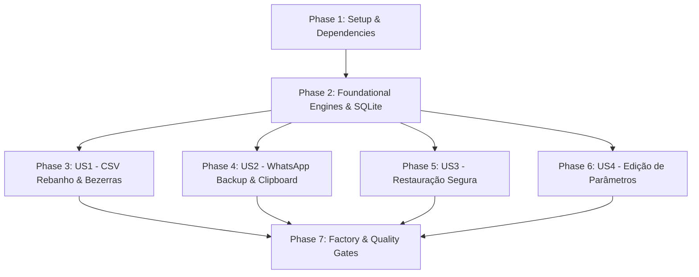

# Tasks: 005-ajustes-e-backup (Ajustes da Fazenda, Exportação CSV e Backup Offline com Compartilhamento WhatsApp)

**Branch**: `005-ajustes-e-backup`  
**Feature Spec**: [spec.md](file:///c:/DEV/github/repro-leite/specs/005-ajustes-e-backup/spec.md)  
**Implementation Plan**: [plan.md](file:///c:/DEV/github/repro-leite/specs/005-ajustes-e-backup/plan.md)  
**Research & Decisions**: [research.md](file:///c:/DEV/github/repro-leite/specs/005-ajustes-e-backup/research.md)  
**Data Model**: [data-model.md](file:///c:/DEV/github/repro-leite/specs/005-ajustes-e-backup/data-model.md)  
**Contracts**: [backup-export-contract.md](file:///c:/DEV/github/repro-leite/specs/005-ajustes-e-backup/contracts/backup-export-contract.md)  
**Quickstart**: [quickstart.md](file:///c:/DEV/github/repro-leite/specs/005-ajustes-e-backup/quickstart.md)  

> [!IMPORTANT]
> **DIRETRIZ DE UI & OFFLINE OBRIGATÓRIA**: Utilizar os primitivos e componentes de `@/ui` (`Botao`, `CampoNumerico`, `Cartao`, `Icon`, `ModalPadrao`, `SeloStatus`, `hapticFeedback`). Todas as operações são 100% offline no SQLite local (`expo-sqlite` + Drizzle) sem dependência de rede ou Supabase.

---

## Phase 1: Setup (Dependencies & Shared Infrastructure)

**Purpose**: Instalação das bibliotecas nativas Expo oficiais e definição de tipos, contratos de portas e serviços compartilhados.

- [x] T001 Install official Expo SDK 57 modules `expo-file-system`, `expo-sharing`, `expo-clipboard`, and `expo-document-picker` via `npx expo install` in `package.json`
- [x] T002 [P] Define backup envelope interfaces and metadata types (`BackupMetadata`, `BackupSummary`, `BackupPayload`, `BackupRecord` types) in `src/features/settings/domain/backup.types.ts`
- [x] T003 [P] Define CSV export row contracts and column configurations (`HerdExportRow`, `CalvesExportRow`) in `src/features/settings/domain/export.types.ts`
- [x] T004 [P] Define persistence repository contract port `BackupRepository` in `src/features/settings/domain/backup.repository.ts`
- [x] T005 [P] Define native file sharing and clipboard contract port `FileShareService` in `src/features/settings/domain/file-share.service.ts`

---

## Phase 2: Foundational (Blocking Prerequisites: Domain Engines & Data Layer)

**Purpose**: Motores determinísticos puros em TypeScript de formatação CSV e validação de backup, implementação do serviço de arquivos e repositório SQLite com transações atômicas.

**⚠️ CRITICAL**: Nenhuma tarefa de caso de uso ou interface pode ser finalizada antes da conclusão desta fase.

- [x] T006 [P] Create unit tests for pure CSV formatting engine with UTF-8 BOM, `;` delimiter, and RFC 4180 quotes in `src/features/settings/domain/__tests__/format-csv.test.ts`
- [x] T007 Implement pure domain CSV formatter engine `formatCsvContent` supporting headers, localized dates, and decimal comma in `src/features/settings/domain/engines/format-csv.ts`
- [x] T008 [P] Create unit tests for pure JSON backup schema validation engine in `src/features/settings/domain/__tests__/validate-backup.test.ts`
- [x] T009 Implement pure domain backup validator `validateBackupPayload` checking version, app name, required entities, and structure in `src/features/settings/domain/engines/validate-backup.ts`
- [x] T010 Implement `ExpoFileShareService` integrating `expo-file-system`, `expo-sharing`, `expo-clipboard`, and `expo-document-picker` in `src/features/settings/infra/expo-file-share.service.ts`
- [x] T011 Implement `BackupSqliteRepository` providing `exportBackup`, atomic `restoreBackup` with `withTransaction`, and CSV query extractors in `src/features/settings/infra/backup.sqlite.repository.ts`

**Checkpoint**: Motores de domínio e adaptadores de infraestrutura testados e compilando sem erros.

---

## Phase 3: User Story 1 - Exportação de Planilhas CSV do Rebanho e Bezerras (Priority: P1) 🎯 MVP Core

**Goal**: Permitir exportar relatórios tabulares em formato `.csv` (Rebanho completo e Bezerras com genealogia e GMD) formatados com UTF-8 BOM e separador `;` para abertura direta no Microsoft Excel e Google Planilhas.

**Independent Test**: Clicar em "CSV Rebanho" e "CSV Bezerras" em `SettingsScreen`; o sistema compila os dados, grava o arquivo temporário e abre o seletor nativo de compartilhamento com dados íntegros e acentuação preservada.

### Tests for User Story 1

- [x] T012 [P] [US1] Create unit tests for `ExportHerdCsvUseCase` and `ExportCalvesCsvUseCase` with fake repository and share service in `src/features/settings/application/__tests__/export-csv.usecase.test.ts`

### Implementation for User Story 1

- [x] T013 [US1] Implement `ExportHerdCsvUseCase` fetching herd rows, formatting CSV with localized dates and sharing via `FileShareService` in `src/features/settings/application/export-herd-csv.usecase.ts`
- [x] T014 [US1] Implement `ExportCalvesCsvUseCase` fetching calves rows, formatting CSV with genealogy/GMD and sharing via `FileShareService` in `src/features/settings/application/export-calves-csv.usecase.ts`
- [x] T015 [US1] Wire up "CSV Rebanho" and "CSV Bezerras" buttons in `SettingsScreen` with loading states and haptic feedback in `src/features/settings/presentation/screens/SettingsScreen.tsx`

**Checkpoint**: Exportação de CSVs do Rebanho e Bezerras 100% funcional e testável de forma independente.

---

## Phase 4: User Story 2 - Backup Seguro em 1 Toque para WhatsApp e Área de Transferência (Priority: P1) 🎯 MVP Backup

**Goal**: Permitir compilar todas as tabelas locais da fazenda em um arquivo `.json` estruturado com metadados de integridade e compartilhá-lo via WhatsApp ou copiar para a área de transferência com um único toque.

**Independent Test**: Tocar no botão "Exportar Backup para WhatsApp (JSON)" e na opção de cópia; verificar a abertura da folha de compartilhamento com o arquivo JSON contendo metadados (`farm_id`, `exported_at`, contagens) e conferir o texto colado no clipboard.

### Tests for User Story 2

- [x] T016 [P] [US2] Create unit tests for `ExportWhatsAppBackupUseCase` and `CopyBackupToClipboardUseCase` in `src/features/settings/application/__tests__/export-backup.usecase.test.ts`

### Implementation for User Story 2

- [x] T017 [US2] Implement `ExportWhatsAppBackupUseCase` compiling all farm entities into versioned JSON file and sharing in `src/features/settings/application/export-whatsapp-backup.usecase.ts`
- [x] T018 [US2] Implement `CopyBackupToClipboardUseCase` serializing compact JSON payload and copying via `expo-clipboard` with haptics in `src/features/settings/application/copy-backup.usecase.ts`
- [x] T019 [US2] Wire up "Exportar Backup para WhatsApp (JSON)" and clipboard copy actions in `SettingsScreen` with progress feedback in `src/features/settings/presentation/screens/SettingsScreen.tsx`

**Checkpoint**: Geração de backup JSON para WhatsApp e cópia para clipboard operacionais e testadas.

---

## Phase 5: User Story 3 - Restauração de Dados a Partir de Arquivo de Backup (Priority: P2)

**Goal**: Permitir importar um arquivo de backup `.json` prévio do ReproLeite, validar a integridade estrutural, exibir resumo com confirmação explícita e restaurar o estado local em transação SQLite atômica.

**Independent Test**: Gerar backup, cadastrar um registro teste, selecionar a restauração do backup anterior e confirmar; a base de dados retorna com fidelidade ao estado anterior sem duplicidade ou órfãos.

### Tests for User Story 3

- [x] T020 [P] [US3] Create unit tests for `RestoreBackupUseCase` validating corrupt file rejection and atomic rollback on error in `src/features/settings/application/__tests__/restore-backup.usecase.test.ts`

### Implementation for User Story 3

- [x] T021 [US3] Implement `RestoreBackupUseCase` orchestrating file selection, schema validation, user confirmation, and atomic restoration in `src/features/settings/application/restore-backup.usecase.ts`
- [x] T022 [P] [US3] Implement `RestoreConfirmModal` component displaying backup metadata summary (animais, IA, pesagens) with warning and confirmation buttons in `src/features/settings/presentation/components/RestoreConfirmModal.tsx`
- [x] T023 [US3] Wire up "Restaurar Dados de Arquivo JSON" button in `SettingsScreen` opening document picker and confirmation modal in `src/features/settings/presentation/screens/SettingsScreen.tsx`

**Checkpoint**: Restauração atômica com validação prévia de schema e modal de confirmação 100% funcional.

---

## Phase 6: User Story 4 - Visualização e Customização dos Parâmetros Zootécnicos da Fazenda (Priority: P3)

**Goal**: Permitir visualizar e editar os prazos reprodutivos e nutricionais da fazenda (janela de cio, toque, gestação, secagem e meta de peso de novilha) com validação de faixas biológicas e persistência no SQLite.

**Independent Test**: Clicar em "Editar Metas e Prazos", alterar o diagnóstico de toque de 45 para 35 dias e salvar; o cartão na tela de Ajustes atualiza imediatamente para 35 dias.

### Implementation for User Story 4

- [x] T024 [P] [US4] Implement `EditSettingsModal` component using `ModalPadrao`, `CampoNumerico` for deadlines/weights, validation rules, and haptic feedback in `src/features/settings/presentation/components/EditSettingsModal.tsx`
- [x] T025 [US4] Update `useSettings` hook with parameter validation logic and wire up "Editar Metas e Prazos" button in `SettingsScreen` in `src/features/settings/presentation/screens/SettingsScreen.tsx`

**Checkpoint**: Edição de parâmetros zootécnicos e persistência com validações biológicas concluídas.

---

## Phase 7: Polish, Dependency Injection & Quality Gates

**Purpose**: Registro das novas dependências e use cases na factory, exportação na API pública da feature e validação completa dos quality gates.

- [x] T026 Update `src/features/settings/factory.ts` registering new backup/export repositories, services, and use cases
- [x] T027 Update `src/features/settings/index.ts` exposing necessary hooks, components, and contracts to external features
- [x] T028 Run strict type checking verification (`npx tsc --noEmit`) and verify 0 type errors
- [x] T029 Run full automated test suite (`npm test`) and ensure all existing and new unit/integration tests pass
- [x] T030 Run code quality and architectural boundary lint (`npx eslint .`) and confirm clean report

---

## Dependencies & Execution Order

### Story Completion Order
1. **US1 (P1)**: Exportação CSV (Rebanho e Bezerras) — Maior valor imediato para consultores e produtores.
2. **US2 (P1)**: Backup WhatsApp e Clipboard — Segurança básica de dados contra perda do aparelho.
3. **US3 (P2)**: Restauração Atômica de Backup JSON — Disaster recovery local.
4. **US4 (P3)**: Edição de Parâmetros Zootécnicos — Customização de metas biológicas.

---

## Parallel Execution Opportunities

- **Phase 1**: `T002`, `T003`, `T004`, `T005` podem ser desenvolvidos em paralelo após a instalação das dependências em `T001`.
- **Phase 2**: Os testes e motores `T006/T007` (CSV) e `T008/T009` (Backup Validator) podem ser desenvolvidos em paralelo.
- **Phase 3 & Phase 4**: Os use cases e testes de CSV (`T012-T014`) e Backup WhatsApp (`T016-T018`) operam sobre arquivos distintos e podem ser implementados em paralelo após a Fase 2.
- **Phase 5 & Phase 6**: Os componentes modais `T022` (`RestoreConfirmModal`) e `T024` (`EditSettingsModal`) são independentes.

---

## Implementation Strategy

1. **MVP Scope (Phase 1 a Phase 4)**:
   - Suporte completo a exportação tabular CSV (Rebanho e Bezerras) e Backup em 1 toque para WhatsApp.
   - Entrega imediata de valor prático para o produtor rural exportar seus dados.
2. **Incremento 2 (Phase 5)**:
   - Restauração de backup JSON com modal de confirmação e transação atômica no SQLite.
3. **Incremento 3 (Phase 6 & 7)**:
   - Edição interativa de parâmetros zootécnicos e fechamento dos quality gates (`tsc`, `jest`, `eslint`).
